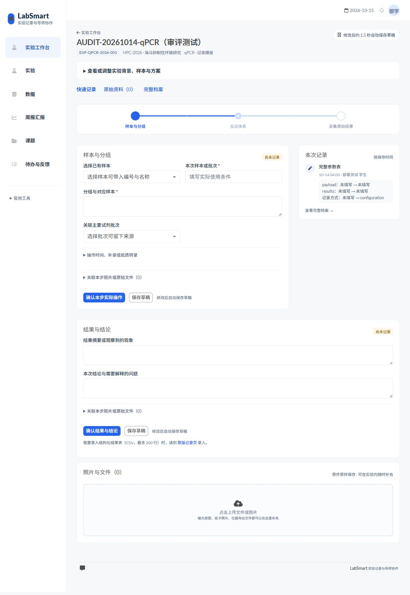
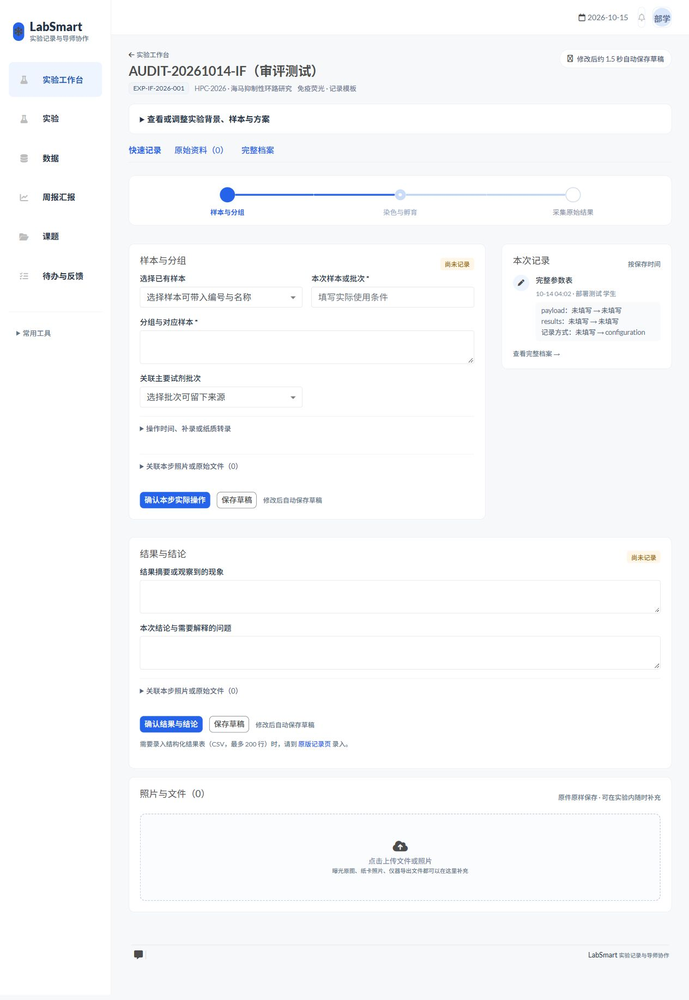
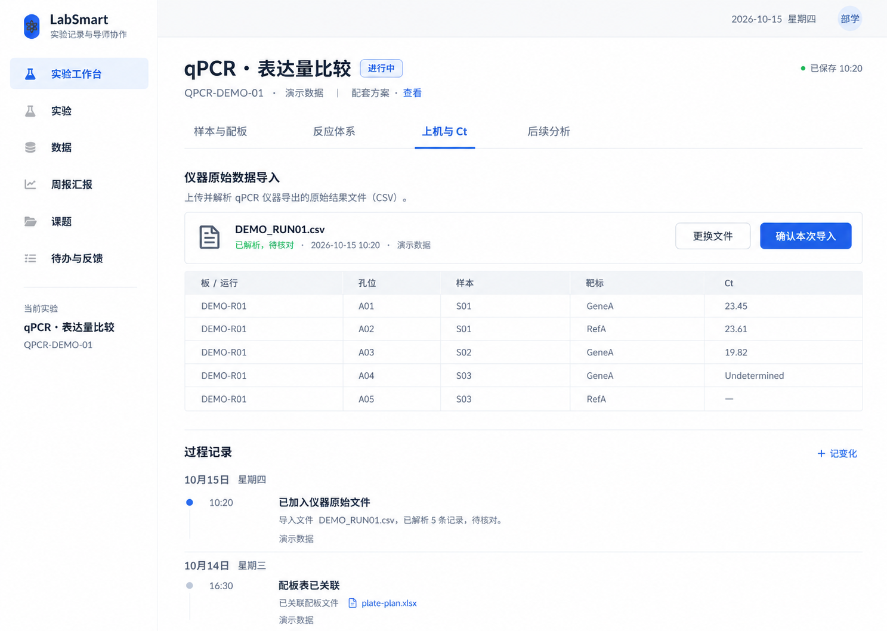
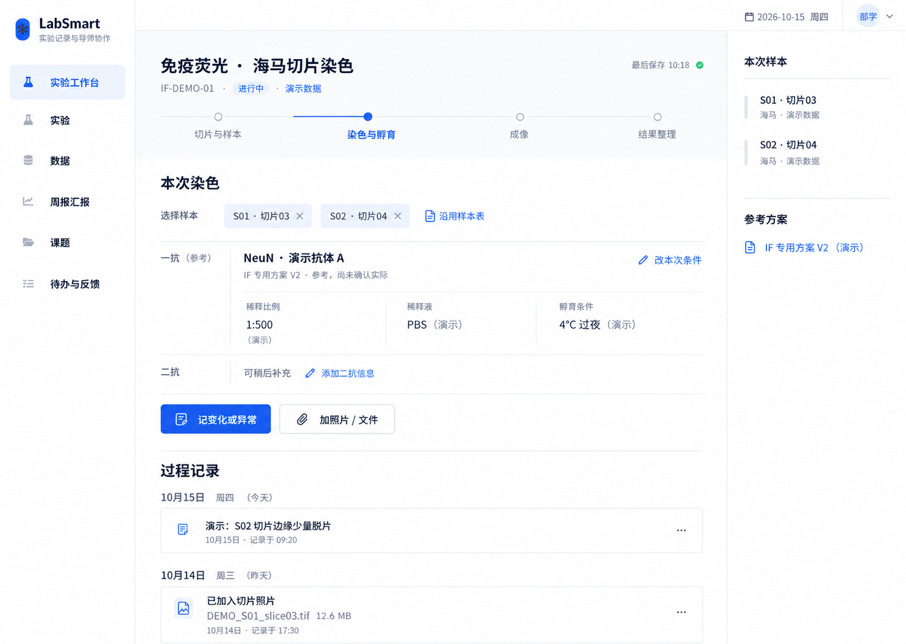
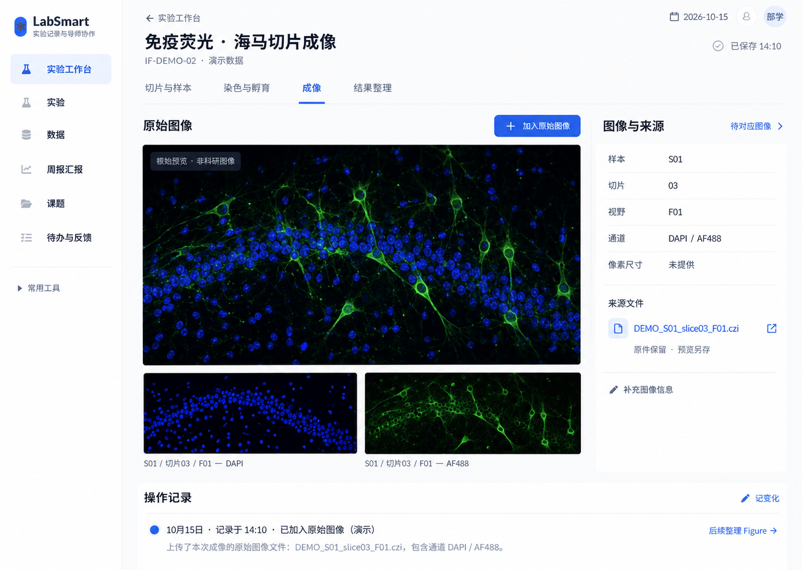

# qPCR 与免疫荧光记录设计

2026-10-15。本轮完成现有页面与源码核对、两类实验的记录逻辑设计及三张视觉方向稿；尚未修改应用代码、数据库或服务器配置。图中的数值、文件及荧光图像均为模拟演示，不是科研数据。使用内置 image_gen 生成，提示词另存于《视觉稿生成提示词.md》。

## 共用的体验原则

沿用用户认可的 WB 方向：同一实验跨天继续，当前阶段和有内容的过程记录优先；资料和条件尽可能复用，学生只记录本次变化。阶段自由切换，结束时统一确认，未知资料允许后补。教师先读过程、异常和结果，再看完整参数与修改历史。

统一视觉风格用于 qPCR 与 IF；各自的业务结构按下面的流程实现。所有常规条件仍需明确出处及版本，参考值、草稿和实际值分别显示，不能因选择模板或浏览某个阶段就宣布已经执行。

## 已核对的现状

实际访问 Linux 预览学生页 `smartlab-record.php?id=5` 与 `id=6`，并读取 `SmartlabBenchRecords::templates()` 和 `smartlab-record.html`。

- qPCR 目前仅有“样本与分组、反应体系、采集原始结果”三段。快速页展示样本/分组必填字段、逐步确认按钮、结果摘要和结论输入框；结构化结果表需要回到原版页面录入。
- IF 目前仅有“样本与分组、染色与孵育、采集原始结果”三段，首屏结构几乎与 qPCR 一致，不能直观看到切片、视野和通道关系。
- 两页的现场历史出现 `payload`、`results`、`configuration` 等内部字段名，缺少人能直接读懂的实验内容。
- 基础的自动保存、修订、实验附件上传和权限能力可以复用。模板与前端的变化必须保持既有记录可读。

本轮只核对可见页面和相关代码，没有提交表单、修改实验事实或验证尚不存在的板/运行、切片/视野实体链路。第一张和第二张图片是当前完整系统的截图。

## qPCR：样本与配板 → 反应体系 → 上机与 Ct → 后续分析

### 样本与配板

优先沿用已有样本/分组表和上一批的配板草稿，允许粘贴或导入现成的 Excel/CSV，不要求逐孔重打。重复实验沿用的是配置，不能把旧批次的 Ct 或已执行状态复制为本次事实。

样本、靶标、内参、孔位与板/运行标识放在同一处查看。多块板不会共用一套无身份的 A01 等孔位。技术重复与生物学样本分开，孔数不能自动等于生物学 n。已有配板图/照片也可先关联，本次尚未整理的样本信息不阻止开始。

### 反应体系

选择已有引物、试剂盒或实验室方案，带入可核验的相关资料和参考条件。检测基因、内参与引物对应关系集中显示，实际体积和程序只在有变化时展开编辑。引物 Tm 不自动等于实验实际退火温度；资料不足时保持未知。

### 上机与 Ct

把仪器原始文件、导入预览、列映射和样本核对放在当前实验内，减少跳回原版页面。导入先保留原件，再预览与核对；同一 Run 可以服务多个实验，关联需要用户确认，名称相似不代表同一样本。

Ct/Cq、Undetermined、No Ct、空值保留原含义，未知值不转成 0。重导入不得悄悄重复加入或覆盖旧数据；排除孔位需要留下原因，旧版本仍可查。正式接入需验证当前仪器格式，不能从概念图推断已实现所有 XLSX/厂家格式。

### 后续分析

继续允许 Excel、Prism 等外部分析。整理后的分析文件或 Figure 与本次原件、运行及样本相连；结束实验不要求先写完整结论或报告。

## IF：样本与载体 → 染色与孵育 → 成像 → 结果整理

### 样本与载体

细胞爬片与组织切片采用各自合适的记录方式：切片实验显示样本/组织/切片关系，细胞实验无需填写脑区或切片编号。沿用已有样本表、实验分组图或载体编号，避免每次重新登记一套信息。开始时无需完整填写动物、组织、脑区、切片等全部字段。

### 染色与孵育

一抗、二抗和核染各有位置，多个靶标按组合呈现。库存说明书或已验证的实验室资料维护一次，学生选择后显示对应的 IF 条件；WB 稀释比例、WB 孵育条件不能直接作为 IF 默认值。

每个抗体的条件和对应通道放在一起，改动一项即可记录。脱片、背景高等异常可随手记在当前过程内，不再与样本/泳道信息混成一个大备注框。

### 成像

默认以图像为主，旁边简洁显示明确的样本、载体/切片、视野和通道，原始文件来源可直接打开。关系能从可靠文件元信息提取时先作为候选展示，不确定的图像暂留“待对应”，不能擅自归到相似样本。

同一视野的通道可一起查看，不同视野不静默合并。缺少像素校准时不画比例尺。显微镜、物镜、曝光等能可靠取得则引用，缺少时允许后补，不作为逐张图像上传的强制表单。

保留 CZI 等原件不等于已经支持其预览；格式暂不可解析时仍能保存和下载，不能用生成的模拟图替代真实预览。视野数、切片数不能自动当作生物学 n。

### 结果整理

原图、分析文件、整理后的 Figure 分别标识，来源关系保留。学生仍可用 Fiji/ImageJ 等专业工具，记录页重点在收拢资料与便于教师阅读。

## 三张视觉方向稿

以下编号与本轮聊天里生成图片的实际显示顺序一致。它们是同一套实验记录工作空间在不同任务中的排版方向，选定视觉体系后用于两类实验。

第 1 张：

第 2 张：

第 3 张：

## 选定方向后的实施与验证

优先实现两类当前实验页、轻量记录、原件入口和可读过程视图，复用 eLabFTW 的上传、版本和权限基础。需要新增持久化结构时使用显式版本迁移，不在页面加载时建表。

qPCR 验证：沿用样本表、保留带板/运行身份的孔位、原件与导入结果一致、未知 Ct 不为 0、重复导入不重复造数据、次日继续同一实验。

IF 验证：细胞/组织记录适配、IF 条件出处正确、原件保存、同一视野通道关系正确、未知校准不生成比例尺、资料不全时仍可记录。

两类共同验证：选择方案不会自动成为实际记录；改一项、加一个原始文件和结束实验不要求完整报告；教师能快速看到样本、变化/异常和结果；刷新后记录仍在；原有数据可读、权限范围不扩大。概念稿不是这些验证已经通过的证据，也不代表完整 V3 验收完成。
