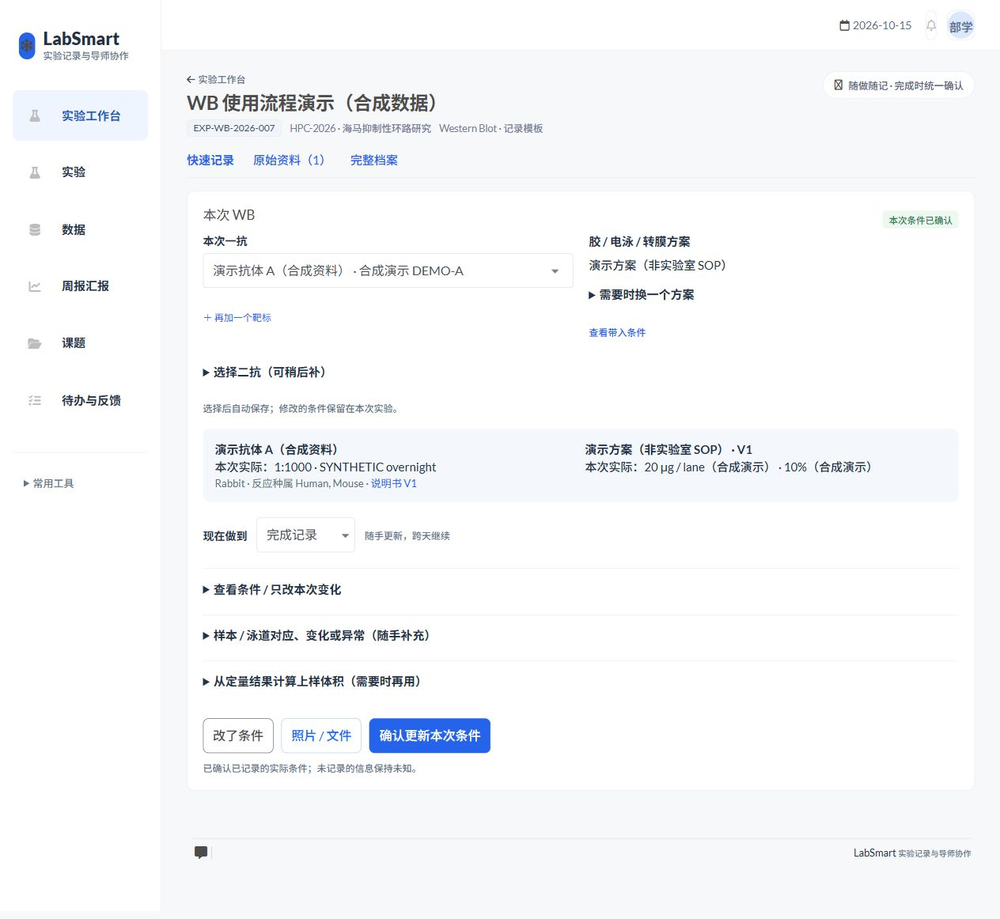
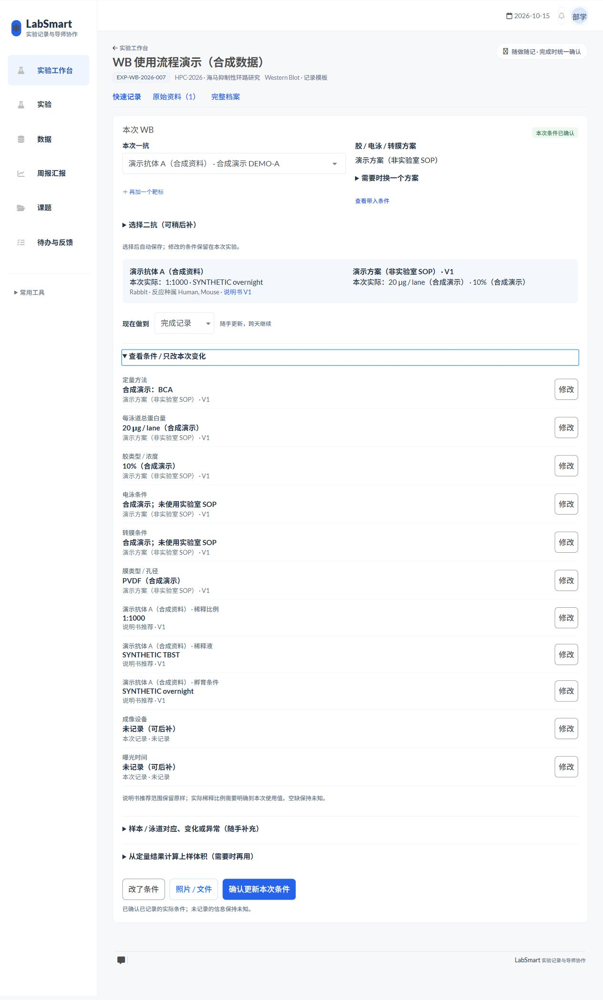
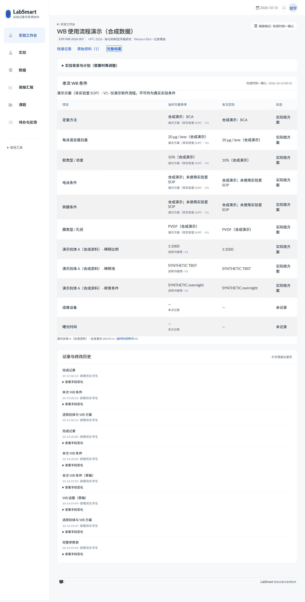

# WB 记录页审评与改版提案

2026-10-15。本轮只审评和提出方案，未修改应用代码、实验记录或服务器配置。按用户最新告知，h3clab 已恢复上网，不再把离线网络作为后续设计工作的限制。

## 结论

上一轮减少了重复填写，但主要依赖折叠字段，没有重新组织记录主线。当前页面先呈现抗体和方案配置，随后是进度，再到条件、样本/泳道/异常和计算工具；回看时又切换成参数对照与保存历史。学生需要自己把这些信息拼成一次实验，教师也需要自行还原过程。

本轮范围为 Linux 独立预览 `https://localhost:3160/smartlab-record.php?id=15` 的学生视图，使用合成演示记录。参考项目根目录的 SMARTLAB_V3_CONTEXT.md 第 3–9 节及 SMARTLAB_V3_ACCEPTANCE.md 第 4、5、18 节，并服从用户最新要求：减轻负担、削弱主动留痕要求、先方案后实施。

## 当前页面证据

1. **进入快速记录页。** 抗体选择和方案配置占据首屏主体。1280 × 720 窗口下，进度控件在页面约 655px 处，主要操作在约 908px 处。页面高度为 1162px。当前阶段和现场记录动作没有形成清晰的第一层级。抗体选择后自动带入条件、可稍后补资料值得保留。

2. **展开条件。** 11 项参数连续排列，定量、电泳、转膜、抗体和成像信息同列展示，每项重复说明来源和“修改”按钮。样本、泳道对应、变化和异常又合并在另一个折叠区。折叠减少了初始输入框，却增加了查找入口和判断归属的成本。单项修改、推荐与实际分开、未知信息不阻断记录值得保留。

3. **打开完整档案。** 先看到大幅参数对照表，再看到“选择抗体与 WB 方案”“本次 WB 条件”“完成记录”等保存动作。历史保留是有价值的，但这一默认读法难以直接回答哪天做到哪一步、发生什么变化、照片对应什么过程。已完成页面仍突出条件确认和重新配置，实验结束状态与条件确认状态的视觉区分也不足。

## 优先修改

| 优先级 | 问题 | 对应改法 |
|---|---|---|
| P1 | 日常记录围绕配置和字段组织 | 以同一实验的当前阶段与过程记录为主体；方案缩成简短上下文 |
| P1 | 条件与实验阶段脱节 | 在对应阶段展示少量相关条件，完整方案继续可查 |
| P1 | 样本/泳道/异常混在一个备注区 | 样本与泳道用可复用的小表或现成分组图承载；变化和异常是独立记录 |
| P1 | 阅读历史以保存动作排序 | 默认按日期、实际记录内容和明确的阶段呈现；详细修改历史另行展开 |
| P2 | 字重、间距、提示和按钮层级重复，重要内容缺少焦点 | 统一排版尺度，减少装饰和重复提示，提高关键内容密度 |
| P2 | 多个“修改”按钮的可访问名称相同，提示文字为 12px | 按钮名称包含参数名；必要说明采用更易读的尺寸与对比度 |

## 建议的页面顺序

### 顶部：明确这是哪次实验

保留实验名、课题、批次编号，以紧凑的一行显示状态、当前阶段和最近记录。已结束实验优先显示“已结束”和回看内容；需要更正时有明确的补充/更正入口。

### 中部：围绕当前阶段随手记录

保留 WB 的自然阶段定位，可以直接跳到任何阶段，不设过关、逐步审批或逐步确认。进入一抗孵育时，看到本次抗体及其带入的稀释、孵育条件；进入成像时，重点呈现原图和相关记录。

选定的抗体和方案以短摘要呈现，不让整个配置表长期占据首屏。当前条件可原位查看和改一项，变化自动保存；统一结束确认继续保留。厂家参考、实验室方案、草稿和实际记录仍须区分，不能从浏览阶段或选择抗体推断已经执行。

现场动作集中为“记变化/异常”“拍照或加文件”。样本/泳道信息可以从已有实验复用、粘贴已有分组表或关联现成照片，允许稍后补，不增加启动必填项。没有记录需求时不需要新增空白条目。定量计算放在上样相关的辅助工具内。

### 下部：读得懂的过程记录

按实际记录日期呈现有内容的变化、备注和文件，把相关图片放在对应记录旁。无法明确对应阶段的文件保留在本实验资料区，不能静默推断。跨天继续同一批实验，展示上次记录和当前阶段。

记录列表服务回看，不要求学生每日打卡，不用每次保存制造一条面向用户的事件。既有细粒度修改历史继续保留。只有记录时间、没有真实操作时间时，必须标明“记录于”，不能补造实验执行时间。

教师查看同一实验时，先看到样本摘要、过程中的变化/异常和结果预览；完整条件对照与详细修改历史按需进入。原始文件和整理后的 Figure 继续分别标识。

## 视觉方向

采用白色为主的阅读页面、浅灰背景、深灰正文和少量现有蓝色强调。减少大卡片、重复边框和大面积无效间隔，明确实验标题、阶段、实际记录三个层级。正文以 16px 为主，必要说明清晰可读；统一行距、表格对齐、按钮尺寸和间距。重要变化用克制的标记突出，常规方案不重复占据视觉中心。

结构化内容仍存在：抗体、条件、样本/泳道、文件分别有明确位置，不能退化成统一的空白文字框。精简的是学生需要判断和重复填写的动作。

## 实施边界与验证方式

第一批只围绕 WB 记录、回看和必要的共用视觉样式。复用当前说明书提取、版本引用、保存、上传及权限能力，不在这一批增加 AI、设备管理或新的强制流程。

用户认可记录顺序后先出视觉稿，视觉方向确定后再改系统。届时用“继续同一实验、改一项条件、加一张照片、跨天回看、教师阅读”逐项验证。样本信息不全时仍应能开始，结束时不强制完整报告，不增加逐阶段确认。

本轮已实际检查三种桌面视图和只读 DOM 信息，未新增或更改实验事实。没有在本轮检查手机、屏幕阅读器、完整键盘路径或色彩对比，因此不宣称完成全面无障碍审查或 V3 验收。测量数据见 layout-observations.json。
