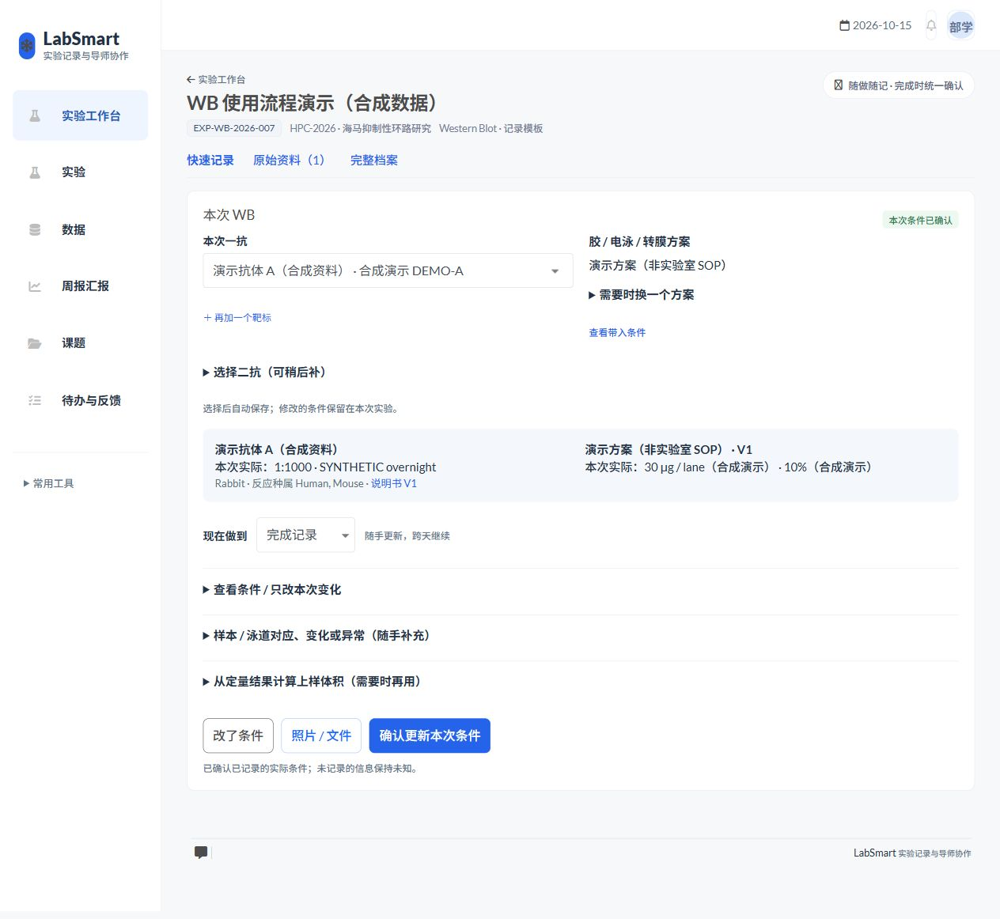
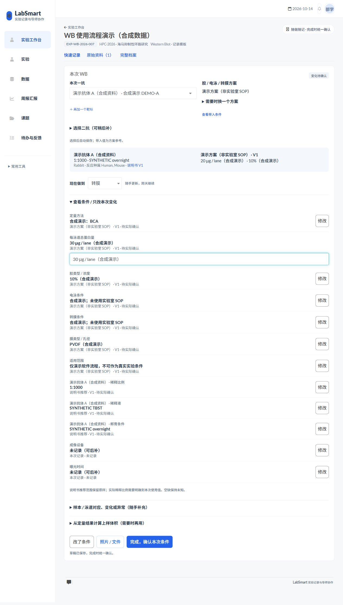
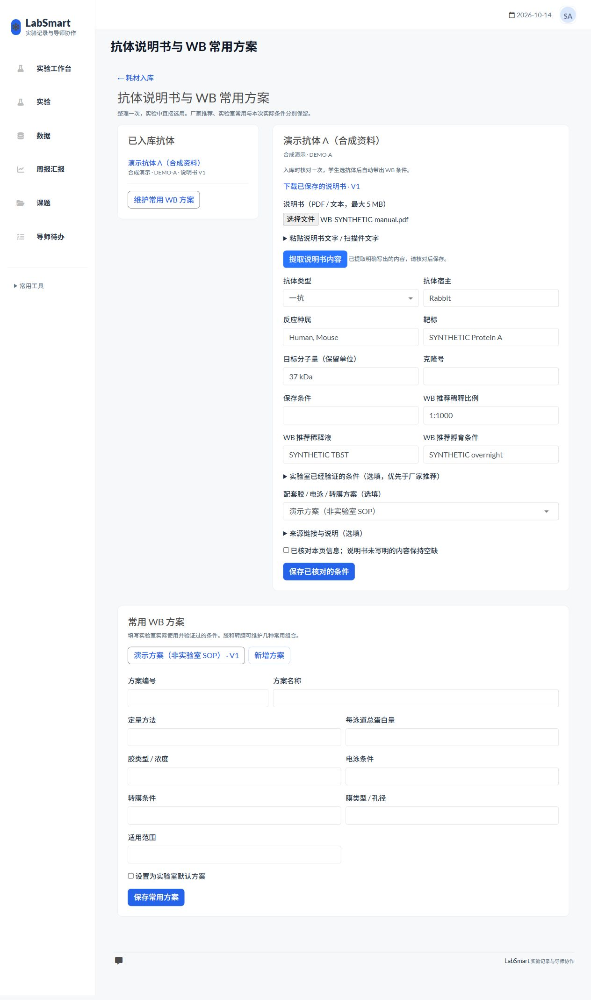
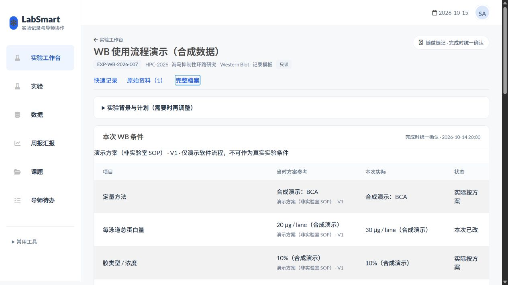
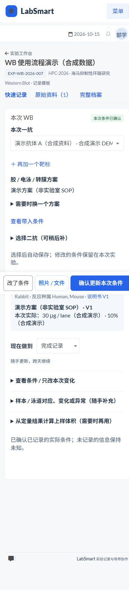

# WB 条件自动带入与 Linux 独立预览

部署于 2026-10-14，收尾验证于 2026-10-15。本轮按最后确认的方向减轻学生负担：入库人员核对说明书一次，学生选择抗体后带出条件，变化随手保存，完成时统一确认。

## 访问与数据基线

访问 [Linux 预览](https://localhost:3160/) 或 [学生 WB 演示](https://localhost:3160/smartlab-record.php?id=15)。当前浏览器已登录学生预览账号，账号沿用本地预览账户。

应用运行在 h3clab 的 `/home/h3clab/smartlab-previews/wb-20261014`。浏览器的 localhost 地址通过 SSH 连接服务器；本机转发断开后可运行 `tools/open-linux-preview.ps1`。这不是服务器直接面向其他电脑的访问地址。

本机完整源码保存在 `C:\项目汇总\AGI项目\smartlab\LabSmart`。服务器是独立的运行源码副本。预览数据库恢复自 **2026-10-14 06:12** 的本地备份，之后新增的本机记录未包含在此次恢复中。原有服务器实例及 C 盘数据库保留。

版本以 **2026-10-14 WB 条件减负预览** 标识；eLabFTW 核心 schema 为 206，新增显式迁移 `003_wb_conditions`。这是本轮 WB 工作流与部署的交付，不代表原 V3 全部需求已通过验收。

## 学生实际需要做什么

1. 开始或继续同一批实验，选择已入库的一抗。抗体和课题也可以稍后补。
2. 配套方案、稀释比例、孵育等条件自动显示。默认不展开文字输入框，二抗和换方案按需展开。
3. 有变化时只打开对应的一项；照片、原始文件和简短说明随时补充。
4. 完成时统一确认。未记录的设备、曝光时间等继续保持未知，提交前不强迫填全。

跨天进度只需选择当前阶段。样本浓度表可在需要时粘贴计算建议的原样本体积，不是启动实验的必填项。计算要求明确的蛋白质量、浓度和单位；不明确时不生成数值，也不把计算建议当成实际移液记录。

教师查看条件对照时，能分辨当时参考、本次实际以及改动项。旧版按步骤填写的记录仍可查阅，新实验不重复显示一整张旧格式空表。

## 说明书与常用方案

耗材入库或已有抗体维护中可以上传文字型 PDF、UTF-8 文本，或粘贴说明书内容。提取明确写出的宿主、反应种属、靶标、分子量和 WB 条件，入库人员核对后保存。厂家推荐、实验室验证过的条件和本次实际记录分别保留。

说明书原件保存 SHA-256 和不可覆盖的版本。更新资料或方案会新增版本；既有实验仍引用当时的版本。不同抗体可以配置不同的胶、电泳和转膜方案；多个一抗配套方案冲突时不自行猜一套通用条件。

真实实验室的定量、上样、胶、电泳及转膜 SOP 还待提供和核实。演示抗体、说明书和数值明确标为**合成数据**，演示方案没有设置成实验室默认方案。扫描 PDF 暂不做 OCR，不同厂家的复杂表格也可能提取不全，未识别字段由入库人员核对，学生仍可先开始实验。

## 验证结果

- 真实数据库：保存、选择版本冻结、推荐与实际分离、范围不擅自变成精确值、单项修改、统一完成确认和重复写入冲突检查通过。验证事务回滚，既有板凳记录未改写。
- HTTP 权限：管理视图直接提交实验条件被拒绝；学生正常进入记录路径，非法阶段值被拒绝且不保存。
- 浏览器：PDF 上传提取后把临时测试值恢复为说明书中的 Rabbit；宿主、反应种属和 WB 稀释比例正确回填。抗体选择、进度保存、原始文件上传、单项自动保存及完成确认通过。
- 演示记录把上样量从 20 改成 30 后，对照表标为“本次已改”；成像设备和曝光时间保持“未记录”。原始上传 PDF 的内容及存储哈希与本机文件一致。
- 1323 个 `src`、`web` 文件与部署版本逐字节校验一致；17 个基线原始附件哈希一致；服务器原有 13 个运行容器保持原实例 ID。
- 手机 390 × 844 布局无横向溢出，默认可见文字输入框为 0，底部操作按钮约 44 像素高。

## 截图

下面是 Linux 完整系统的实际截图，使用合成演示资料。编号 01–03 的旧图片是早期离线组件检查，不是服务器页面。

学生快速记录：

只修改一项：

入库人员核对说明书一次：

教师只读条件对照：

手机操作：

## 部署耗时与网络原因

此前没有记录整体工作各部分的精确时间比例。这次迁移阶段主要处理了部署兼容与网络问题；配置稳定后，最近一次已测的源码构建和健康启动耗时 **18.8 秒**，不含首次环境准备、传输和功能验证。

10 月 14 日排查时，mihomo 当前代理节点返回 `connection refused`，国际 HTTPS 下载失败；百度、中科大和清华镜像站 HTTPS 可访问，未见校园网认证页面跳转。构建改用可用的国内镜像站，预览运行已恢复。这不等于已修好 mihomo 的国际代理链路。

部署配置和重连说明见 `deploy/linux-preview/README.md`。独立预览在形成真实数据前，仍应完成真实 SOP 核对及针对实际课题的试用反馈。
