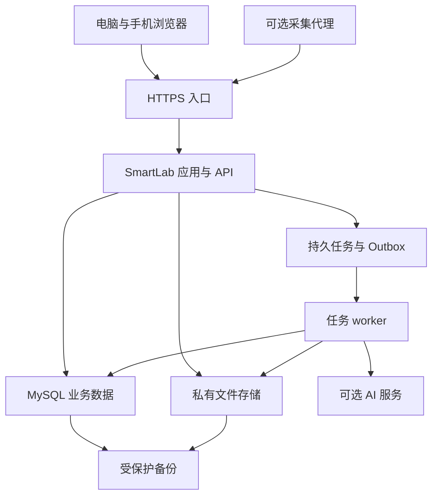

# SmartLab 开发需求与实施规格

**版本：V1.0｜日期：2026-10-13｜交付对象：产品设计、前后端开发、测试与部署人员**  
**产品名称：SmartLab；与既有 Tingan LabSmart V2 的命名、账号及数据保持兼容。**  
**文档用途：需求说明、实施方案、页面设计依据、开发拆分和验收依据。**

> 核心目标：让学生按照科研计划完成实验，在同一实验批次中逐步留下真实记录、参数变化和原始文件；学生自行分析并整理 Figure，每周或每两周汇报一次，导师的讨论意见接入下一轮实验计划。
>
> 本文件是可交给工程师的实施规格，尚不代表已经完成软件开发。此前展示的界面和图像属于设计探索，不等于已验收的正式页面。本次没有读取现有代码仓库或数据库，因此涉及既有技术栈的内容属于兼容基线，工程师须按第 21 章核对现状。

## 目录

1. [需求依据与实施约定](#s01)
2. [产品范围与阶段划分](#s02)
3. [角色、权限与可见范围](#s03)
4. [业务对象与关系](#s04)
5. [贯穿示例与真实使用过程](#s05)
6. [状态、快照与历史规则](#s06)
7. [信息架构与统一交互](#s07)
8. [页面规格：实验工作台与新建实验](#s08)
9. [页面规格：WB 快速记录与数字档案](#s09)
10. [手机暂存、纸卡与补录](#s10)
11. [原始文件、仪器数据与导入](#s11)
12. [Figure 库与来源追溯](#s12)
13. [定期汇报、导师反馈与下一轮计划](#s13)
14. [qPCR、IF 与通用实验模板](#s14)
15. [AI、知识库与手动索引](#s15)
16. [数据库及字段字典](#s16)
17. [API、并发与事务契约](#s17)
18. [技术架构与实现模块](#s18)
19. [文件存储、导出及恢复](#s19)
20. [性能、兼容性与安全基线](#s20)
21. [既有系统核对及升级迁移](#s21)
22. [开发顺序、截图评审与交付清单](#s22)
23. [测试场景与验收标准](#s23)
24. [需求追踪矩阵](#s24)
25. [默认决策、待核实项与技术参考](#s25)
26. [给实施工程师的执行摘要](#s26)

<a id="s01"></a>
## 1. 需求依据与实施约定

### 1.1 用户已明确的需求

下表是本产品不可随意改变的业务要求。工程师不得以实现方便为理由改变主流程。

| 编号 | 明确需求 | 落地解释 |
|---|---|---|
| R-01 | 从学生做实验的角度设计 | 主界面显示正在开展的具体实验、当前实验内容和记录入口，不能以待办清单充当实验平台 |
| R-02 | 推进实验记录数字化 | 数据最终汇入数字实验档案，纸本是现场过渡输入；纸本照片也要有归属和后续整理入口 |
| R-03 | 学生按计划做实验 | 课题、科学问题、实验方案、样本和分组相互关联，不能每次从空白表单重写 |
| R-04 | 一次实验可以跨几天 | 连续记录归属同一实验批次；刷新、重新登录、换设备或跨天不能自动新建批次 |
| R-05 | 标准 Protocol 自动带入 | 显示来源和版本；实际变化单独记录；未确认的默认参数不能冒充已经执行的事实 |
| R-06 | 快速记录只记变化和异常 | 常用条件带入，学生点选变化项、写备注、拍照或添加文件；允许先暂存、后补全 |
| R-07 | 支持纸卡与仪器数据归档 | 纸卡、现场照片、完整原图、Ct 原始表等归入对应实验；无法判断归属时进入待归属区 |
| R-08 | 不要求每次实验写报告 | 日常实验记录和周／双周汇报是不同对象，实验完成不能触发强制写报告 |
| R-09 | 汇报使用学生整理好的 Figure | 学生自主处理、标注、排版，再上传成图；原始图通过来源关联追溯 |
| R-10 | 每周或每两周汇报 | 周期可配置；汇报草稿由所选 Figure、实验背景和问题组织，学生确认后提交 |
| R-11 | 导师反馈进入下一轮计划 | 意见先转为可编辑实验计划草稿，由学生确认执行，不能悄悄增加待办或自动改方案 |
| R-12 | WB、qPCR、IF 记录各有特点 | 同一底层工作方式，分别提供泳道／抗体、板位／Ct、视野／通道等专用组件 |
| R-13 | 每轮先看少量系统截图 | 按场景提供 2–3 屏、一页一屏的 PDF 或 PPT，附操作解说；本文件不视为视觉稿通过 |
| R-14 | 导师、学生、管理员三角色 | 权限在服务端校验；管理员身份不自动等于科研内容全可读 |
| R-15 | 本地优先、可运行、可备份恢复 | 默认实验室服务器和局域网部署，账号、数据库、附件真实保存，不能以静态页验收 |
| R-16 | AI／embedding 处理可控 | AI 按用户明确点击触发；知识索引保留手动启动与失败重试，不能新增自动全库索引 |

### 1.2 建议默认值与已确定需求的区分

文档中的页面编号、状态枚举、字段格式、技术选型、阈值和部署参数是为防止工程歧义给出的**建议默认值**。这些默认值可以用于直接实施，但必须在开发说明中保留；如修改，应提交变更记录并说明影响，不能称为用户曾经亲自指定。

默认采用：中文界面；实验室时区 `Asia/Shanghai`；电脑与手机浏览器；一套服务支持多个项目；组织内按项目隔离；WB 全流程先完成，再扩展 qPCR 和 IF。技术默认采用第 18 章的兼容升级方案，禁止无依据重建数据库或覆盖既有部署。

### 1.3 需求语言

- **必须**：对应范围内的验收条件，不实现就不能通过该阶段。
- **默认**：本文件给定的实施决策；没有明确变更就按此执行。
- **可选**：不计入基础版报价及验收，除非被纳入具体开发范围。
- **预留**：具备扩展接口或数据结构，不代表提供可使用功能。

“支持上传”和“支持解析”不同；“可以查看”与“可以编辑”不同；“已保存到本机”与“已保存到服务器”不同；“已有方案默认值”与“确认实际执行”不同。界面、代码和验收必须保持这些区别。

<a id="s02"></a>
## 2. 产品范围与阶段划分

### 2.1 产品定位

SmartLab 是面向实验室的实验工作平台。工作组织层次为“课题／研究问题 → 实验计划 → 实验批次 → 持续记录与原始资料 → 分析与 Figure → 定期汇报 → 下一轮计划”。首页突出当前实验，课题里程碑为背景和进展管理服务。

不采用打卡、排名、连续登录天数或学生活跃度评分。记录的完成程度只用于提示证据缺口，不等于实验质量、学生绩效或科研结论可靠性。

### 2.2 交付分期

**基础版交付范围 = M0 + M1 + M2。M1 是第一轮可运行版本，不等于整个基础版交付完成。M3、M4 属于单独可选扩展。**

| 阶段 | 范围 | 阶段出口 |
|---|---|---|
| M0：设计与现状核对 | 核对现有系统；确定页面与数据映射；逐轮截图评审 | 形成截图稿、页面说明、差异清单、可执行开发清单 |
| M1：WB 完整闭环 | 登录三角色、项目／计划、Protocol、样本、跨天 WB 记录、手机／纸卡手动归档、文件、Figure、周／双周汇报、导师反馈、备份恢复 | 能用真实数据库和附件走通第 5 章；通过 M1 验收 |
| M2：基础版补齐 | qPCR 板位／Ct 导入与解析、IF 视野／通道、通用实验模板、里程碑、导出和完整基础验收 | M1 + M2 全部必须项通过；基础版正式交付 |
| M3：可选仪器采集 | 指定目录采集代理、NAS 入口、设备配对、断网重传、待归属收件箱 | 指定设备与目录实测通过；不默认覆盖所有仪器 |
| M4：可选 AI／知识库 | 手动纸卡识别、记录／汇报草稿、可配置模型、手动索引、引用式检索 | AI 关闭时核心流程仍可用；草稿和索引均有人工控制 |

M1 必须提供人工上传和人工确认归属，不能以“等 M3 自动采集做好”阻塞文件归档。M1 的纸卡必须可拍照、扫码、归属和人工转录；M4 的 OCR 是提升效率的扩展。

### 2.3 首版不纳入的功能

以下内容不计入基础版：设备远程控制、仪器驱动统一集成、自动判读条带或细胞、自动生成科研结果、AI 替学生作图、自动写完整论文、全套 ELN／LIMS／资产采购库存系统、动物房管理、排课考勤、收费订阅、原生 Windows 客户端、原生手机 App、微信小程序、实时多人协同编辑。

网站可在 Windows 浏览器使用。M3 采集代理是仪器电脑上的辅助程序，不是 SmartLab 主客户端。第三方分析软件继续用于学生分析；SmartLab 接收和关联分析文件与成图。

### 2.4 基础成功标准

学生无需每次重复输入同一 Protocol；一次参数变化可在已有实验中用“打开变化项 → 输入 → 保存”完成；跨天记录不分裂；现场暂存与仪器原图可以找到具体批次；整理后的 Figure 能找到使用的样本、原始文件和分析文件；汇报引用固定 Figure 版本；导师意见能形成下一轮实验草稿；服务重启和恢复备份后资料可用。

<a id="s03"></a>
## 3. 角色、权限与可见范围

### 3.1 组织与成员

组织 `Lab` 是数据隔离边界，项目 `Project` 是科研内容可见边界。基础版默认一个实验室组织，数据库仍保存 `lab_id`，防止今后扩展时混用数据。项目成员必须显式授予“导师／学生／只读协作者”身份；只读协作者是项目权限，不新增系统第四角色。

账号由管理员创建或邀请，基础版关闭公开自行注册。系统角色和项目角色分开：系统管理员负责账号、配置与维护；导师负责被分配项目中的指导；学生负责被分配项目中的实验。一个人可以兼有管理员和导师身份，但只有显式项目成员身份才授予科研内容读取权。

### 3.2 权限矩阵

| 操作 | 学生 | 导师 | 系统管理员 |
|---|---|---|---|
| 登录、修改本人密码／资料 | 是 | 是 | 是 |
| 创建课题 | 否；由导师建立 | 是 | 仅兼有导师或获项目授权时 |
| 查看项目科研内容 | 本人所属项目 | 本人指导／所属项目 | 默认无；需项目授权 |
| 新建实验计划／批次 | 所属项目内 | 所属项目内 | 按项目角色 |
| 编辑实验执行记录 | 本人负责或被指定协作的实验 | 不直接替学生改执行事实；可评论 | 不直接修改科研事实 |
| 查看同项目其他学生实验 | 可以只读 | 可以 | 按项目角色 |
| 修改他人的实验 | 仅获实验协作编辑权限 | 可编辑计划建议，不能改其执行记录 | 否 |
| 发布标准 Protocol 版本 | 可提交草稿 | 可以 | 按项目角色 |
| 上传／关联文件 | 有编辑权的实验或本人 Figure | 所属项目内自己的资料 | 按项目角色 |
| 归档实验 | 实验负责人 | 可以归档，需说明 | 按项目角色 |
| 提交汇报 | 本人汇报或被指定汇报协作者 | 本人汇报；可指导学生 | 按项目角色 |
| 反馈／结束讨论 | 可回复、确认行动 | 可反馈、退回或结束讨论 | 按项目角色 |
| 管理账号与部署配置 | 否 | 否 | 是 |
| 发起备份／恢复 | 否 | 否 | 是，恢复须维护窗口 |
| 跨项目读取／搜索／下载 | 禁止 | 禁止，除非已获该项目授权 | 同样须项目授权 |

“同项目可读、本人／显式协作可写”是基础默认。项目退出后立即撤销在线权限；已有汇报里的署名与历史记录保留。账号停用不能删除其历史执行人、评论或文件。

### 3.3 校验位置

所有 API、文件下载、缩略图、导出、搜索、后台任务、AI 检索和采集代理均校验权限。禁止只在前端隐藏菜单。服务端从会话读取操作者和所属组织，不能信任请求体传入的 `user_id`／`lab_id`。外组织对象返回 404；同组织已知对象但缺操作权限返回 403。

管理员需要维护科研内容时，先给自己增加有期限的项目只读授权并记录原因；不得提供未记录的“超级用户随意改记录”入口。生产数据库物理访问由运维控制，应用层权限不等于物理管理员隔离。

<a id="s04"></a>
## 4. 业务对象与关系

### 4.1 术语表

| 对象 | 定义 | 关键区别 |
|---|---|---|
| 课题 Project | 一项持续研究，包含研究问题、成员与阶段目标 | 不是单次实验 |
| 里程碑 Milestone | 一个需要研究证据支持的阶段目标 | 不要求每天打卡 |
| 实验计划 Plan | 下一次准备解决的问题、样本、分组、方案和预期输出 | 可以产生多个独立实验批次 |
| Protocol | 可复用标准方案 | 发布版本不可覆盖；尚未表示某批次实际执行 |
| 实验批次 Experiment | 一次连续实验执行，具有稳定编号、样本、方案快照与记录 | 可以跨天；技术重复、复做通常建立新批次并关联原批次 |
| 实验阶段 Step | 一批次中的操作阶段，如电泳、转膜、孵育 | 是记录定位标签，不是强制待办审批 |
| 快速记录 RecordEvent | 一次变化、异常、备注、参数确认、照片或补充记录 | 追加历史，不覆盖旧事实 |
| 暂存 Capture | 尚未完全整理的文字、纸卡照片或现场照片 | 有归属状态；不自动变成已确认实验参数 |
| 原始文件 Asset | 原始曝光、仪器导出表、现场照片等不可覆盖的文件对象 | 展示缩略图不是原文件替代物 |
| 分析 AnalysisRun | 学生的一次分析过程，说明输入、方法、软件和输出文件 | 基础版不负责自动计算所有分析 |
| Figure | 一个结果图主题，具有多个不可覆盖版本 | 版本引用具体成图和来源，不追踪浮动“最新版” |
| 定期汇报 Report | 围绕一段时间内研究结果和问题组织的汇报 | 汇报提交形成快照，不逐次实验强制生成 |
| 导师反馈 Feedback | 对汇报／Figure／实验的评论与实验建议 | 转计划前须由学生检查草稿 |

### 4.2 关系约束

一个项目有多份计划；一份计划可产生多个实验；一个实验属于且只能属于一个项目。一个实验可以有多种文件和多个分析。一个 Figure 版本可以引用同项目内多个实验、分析和文件。一个汇报可以引用多个 Figure 版本；同一 Figure 版本可以用于多次汇报。

一个样本可以参与多个实验。`Sample` 是原始样本身份，`ExperimentSample` 是本次使用情况。泳道、孔位和视野关联本次使用情况，不能直接把组别名称当作样本 ID。

默认禁止 Figure／分析跨项目混合来源。确需跨项目共同分析时，先显式建立共同项目并授权成员，不能通过绕过权限的附件链接实现。

原始材料与派生材料采用有方向的来源链：原始 Asset → AnalysisRun → FigureVersion → ReportSnapshot。AnalysisRun 也可引用其他 AnalysisRun 的输出，但保存前须检查无环路。同一个文件可以作为多个 Figure 的来源，不要复制多个逻辑相同的原件。

<a id="s05"></a>
## 5. 贯穿示例与真实使用过程

### 5.1 演示数据约定

全程使用 `WB：GAD67（5xFAD 海马）`。演示项目为“海马抑制性环路研究”，学生“演示学生 A”，导师“演示导师”，实验编号 `WB-20261013-001`；分组 `WT`、`5xFAD`、`5xFAD+PCN`；样本使用 `HPC-001` 等虚构编码。

全部示例参数、文件、分组与图像标记“演示数据，非真实实验结果”，不能作为用户已有预实验或科研结论。示例分组不代表正式研究设计或给药建议；技术人员不得为了演示生成伪造的原始科研数据。

### 5.2 使用过程

| 场景 | 学生操作 | 系统行为 | 留下的对象 |
|---|---|---|---|
| 周期开始 | 从计划打开 WB，核对样本和方案 | 固定方案版本及样本快照，建立一个批次 | Plan、Experiment、Protocol 快照 |
| 第一天 | 查看步骤，确认实际样本，记录上样量变化 | 只写变化和确认事件；其他参数仍标“方案默认／未确认” | RecordEvent、样本／泳道确认 |
| 第二天 | 打开同一批次继续孵育，记异常或拍纸卡 | 沿用同一编号；记录操作时间和补录时间 | RecordEvent／Capture |
| 获取数据 | 上传完整曝光原图与仪器导出文件 | 保留字节、文件名、校验值；确认归属 | Asset、ExperimentAsset |
| 整理档案 | 补充纸卡信息，检查样本、实际条件和附件 | 生成可读数字实验档案，显式显示证据缺口 | 实验档案视图 |
| 分析 | 在 ImageJ、Prism 等工具分析并上传文件 | 记录输入文件、方法、分析文件和排除原因 | AnalysisRun |
| 做图 | 自行整理、标注并上传 Figure V1 | 关联原图／分析和样本；后来修改形成 V2 | Figure、FigureVersion |
| 周／双周汇报 | 选择整理图，写问题，整理草稿并提交 | 冻结本次使用的 Figure 版本和说明 | Report、ReportSnapshot |
| 讨论之后 | 接受导师建议，编辑“补充实验”草稿 | 引用对应反馈、科学问题及必要条件 | 下一轮 Plan |

### 5.3 “继续”和“复做”的判定

同一膜的跨天孵育、同一批次文件补传、同一实验的补记属于“继续记录”。重新制样、重新跑胶或独立复验属于“基于此实验新建复做批次”，生成新编号并保存 `repeat_of_experiment_id`。用户选择“新建复做”时复制计划、方案和样本选择，**不复制旧执行事件、已完成状态或旧文件归属**。

<a id="s06"></a>
## 6. 状态、快照与历史规则

### 6.1 实验状态

| 内部值 | 中文显示 | 允许操作 | 进入条件 |
|---|---|---|---|
| `draft` | 待开始 | 编辑计划引用、样本、方案版本；删除空草稿 | 已建立但尚未开始执行 |
| `in_progress` | 进行中 | 确认条件、追加记录、上传数据、分析 | 负责人点击“开始实验” |
| `paused` | 暂停 | 追加说明、传文件、恢复或结束 | 负责人选择暂停并说明 |
| `completed` | 本次实验结束 | 追加补录、分析、Figure、关联文件 | 人工确认本次操作结束；不要求提交报告 |
| `archived` | 已归档 | 只读、评论、导出、建立复做批次 | 已结束且负责人选择归档 |
| `cancelled` | 已取消 | 只读、补充取消说明、导出 | 负责人明确取消并填写原因 |

合法转换：`draft → in_progress/cancelled`；`in_progress → paused/completed/cancelled`；`paused → in_progress/completed/cancelled`；`completed → in_progress/archived`；`archived → completed`（负责人或导师说明原因）；`cancelled` 不重新开展，需新建批次。禁止依日期或进度百分比自动改变实验状态。

实验结束允许存在记录缺口，但必须展示缺口并让负责人确认“已知存在待补资料”；不能显示为证据完整。归档要求：无未提交的执行记录草稿，无待归属暂存，无处理中上传，样本与关键实际参数的确认状态已明确；允许失败实验或缺原图归档，但必须填写“资料缺失说明／失败说明”。归档不表示导师认可结论。

### 6.2 参数来源与确认状态

每个参数显示一个互斥状态：`default_unconfirmed`（方案默认、实际未确认）、`confirmed_as_default`（实际按方案）、`overridden`（实际已改）、`not_applicable`（本次不适用）、`unknown`（实际未记录）。

实验开始时，系统把 Protocol 版本复制为不可覆盖的批次方案快照；实际条件初始为 `default_unconfirmed`。用户可以对选中阶段点击“实际按此方案执行”，只确认选中的参数，保留操作者及时间。确认不能顺带将未执行阶段标为完成。

修改参数保存前后值、单位、适用阶段、发生时间、操作者、来源和可选原因；异常记录至少说明异常内容，不强制填写解决措施。批次实际参数由已确认事件重建，不能直接改 Protocol 来表示本次变化。

### 6.3 记录与补录

正式记录一经保存，历史不可覆盖。纠正使用“更正此条”，产生新事件，引用 `supersedes_event_id`，保留更正原因和原文。草稿允许直接编辑；用户主动保存后成为正式事件。误记用作废事件处理并注明原因，不物理删除正式记录。

`occurred_at` 是实际操作发生时间，`recorded_at` 是服务器接收时间；两者保存 UTC，界面按实验室时区显示。所有记录保存两种时间；仅用户主动选择补录或发生时间比接收时间早超过默认 10 分钟时显示“补录”，普通网络延迟不算补录。可选“时间约为”标识。排序默认按发生时间，支持切换录入时间；来自离线客户端的时间不能作为审计时间。发生时间在服务器当前时间之后超过 5 分钟时要求校正或确认设备时钟，不允许未来时间悄悄成为当前参数。

正式事件类型默认固定为：`note`、`parameter_confirmation`、`parameter_change`、`anomaly`、`step_state_change`、`sample_mapping_change`、`correction`、`void`、`state_change`。各类型有独立校验 schema。归档／取消后不接受新的执行事实或本批次文件关联，须先按合法状态转换恢复；评论、独立 Figure 新版本引用已有资料不改变原批次归档内容。

### 6.4 版本固定规则

- Protocol 发布后不能原位改；修改生成新版本；已开始实验不跟随升级。
- 样本在开始实验时保存本次身份／组别快照；更正用事件，不静默修改旧分析与汇报。
- Figure 上传更新产生新版本；旧汇报继续引用旧版本。
- 汇报提交产生完整快照；导师反馈不能修改学生原始记录或已提交正文。
- 归档撤销、样本更正、文件重关联、版本撤回等均有操作者、时间和原因。

<a id="s07"></a>
## 7. 信息架构与统一交互

### 7.1 导航

电脑端一级导航：实验工作台、课题与计划、实验档案、Figure 库、汇报与讨论、方案库。可选扩展启用后出现资料检索；管理员单独有账号／配置／备份入口。待归属文件和纸卡通过工作台“待归入资料”入口访问，不把收件箱变成主界面。

实验内部固定页签：`快速记录｜完整档案｜原始资料｜分析与 Figure｜讨论`。当前阶段是记录上下文，不采用强制“下一步审批”向导；学生可以按真实实验顺序进入任何相关阶段。

手机端主要导航：当前实验、快捷记录、待补资料、我的 Figure／汇报。复杂泳道或板位配置优先电脑操作，手机必须能看已有表并编辑单条记录。

### 7.2 风格与布局默认

白底、蓝色主色、适度分组和清楚的科研信息层级。建议主色 `#2563EB`、背景 `#F5F7FB`、文字 `#172033`；错误／异常用文本与图标共同提示，不能只靠红绿区分。界面默认显示实验名称、编号、样本与当前阶段，图和资料拥有足够显示面积。

电脑设计基准 1440×900，验收包含 1366×768；手机基准 390×844，支持宽度 360–430。桌面正文不小于 14 px，手机正文不小于 16 px，主要触控目标至少 44×44 px。表格可横向滚动但页面主体不能整体横向溢出。正文不要出现数据库、embedding、token 或队列等工程术语，配置和管理员页面除外。

### 7.3 保存、反馈与错误

编辑时自动保存的是“编辑草稿”，正式实验事件由用户点击“保存记录”提交。输入停止约 2 秒后尝试保存草稿；显示 `保存中／草稿已保存到服务器／暂存在本机／保存失败`。服务器返回成功及记录 ID 后，才能显示“记录已保存”。

基础版不提供全功能离线系统，仅支持已打开实验的文字／少量照片暂存，第 10 章规定边界。切换页签或关闭页面前未提交正文必须保留草稿；上传失败不能清空文件选择或其他输入。错误应包含具体原因和下一步，如“原图已上传，但尚未选择实验归属”，不得只提示“失败”。

### 7.4 操作数量

已有实验中新增一条单参数变化：从快速记录页进入编辑后，不超过 3 个主要操作（选择变化项、输入值、保存）；复杂样本选择不计为普通参数变化。照片暂存从当前实验进入不超过 3 个主要操作；有归属的照片保存时无需再次选择同一实验。不得为正常保存增加强制填写标题、报告摘要、导师审批等额外步骤。

所有空状态均提供清楚入口：没有实验时“从计划开始／新建实验”；没有原图时“上传原始资料”；没有 Figure 时“上传已整理的图”；没有汇报时“新建本周期汇报”。不通过生成假数据填补空状态。

<a id="s08"></a>
## 8. 页面规格：实验工作台与新建实验

### 8.1 页面清单与路由

| 页面编号 | 名称 | 建议路由 | 阶段 |
|---|---|---|---|
| P01 | 学生实验工作台 | `/workbench` | M1 |
| P02 | 课题与实验计划 | `/projects/:id/plans` | M1；里程碑 M2 |
| P03 | 新建／复做实验 | `/experiments/new` | M1 |
| P04 | WB 快速记录 | `/experiments/:id/record` | M1 |
| P05 | 完整数字实验档案 | `/experiments/:id/archive` | M1 |
| P06 | 原始资料／待归属区 | `/experiments/:id/assets`、`/inbox` | M1 |
| P07 | 手机快捷记录／纸卡 | `/m/experiments/:id/capture` | M1 |
| P08 | Figure 库／详情 | `/figures`、`/figures/:id` | M1 |
| P09 | 周／双周汇报编辑与阅读 | `/reports/:id` | M1 |
| P10 | 导师讨论与反馈 | `/supervision`、`/reports/:id/discussion` | M1 |
| P11 | qPCR 记录／板位 | `/experiments/:id/record`，按类型渲染 | M2 |
| P12 | IF 记录／视野 | `/experiments/:id/record`，按类型渲染 | M2 |
| P13 | Protocol 库与版本 | `/protocols`、`/protocols/:id/versions/:v` | M1 |
| P14 | 账号／配置／备份 | `/admin` | M1 |
| P15 | 纸卡整理与补录 | `/captures/:id` | M1 |

页面跳转必须使用数据库真实 ID；直接刷新详情路由应可正常加载；路由和菜单不是权限控制的替代品。

### 8.2 P01 学生实验工作台

**学生此刻的问题：我正在做哪一次实验，做到哪里，记录和资料在哪里？**

上方：当前项目选择、搜索实验／样本、账号；左侧：固定一级导航；中央主体：正在进行的实验工作区。默认只显示本人负责／协作的进行中与暂停实验，按最近实际记录时间排序；通过筛选查看结束或全部项目实验。

每个实验区至少包含：实验名称与类型、批次编号、研究问题一句话、当前阶段／最后记录、样本和分组摘要、方案版本、最新现场记录／附件缩略图、主要按钮“继续实验”、次要按钮“完整档案”。实验多于 6 个时分页或按项目折叠，不变成大量小待办项。

下方放“最近整理的 Figure”和“待归入本次实验的资料”；侧区可放“本周期汇报”和最近导师讨论。首页不出现“今日必须完成 7 项”“逾期学生排行榜”。仅上传失败、未归属资料等与当前工作直接相关的提示显示数量。

**点击行为：**

- “继续实验”：直接进入 P04，保留当前阶段和未提交草稿；不得新建批次。
- “新建实验”：进入 P03，优先从已有计划建立，也可先建立计划草稿。
- 文件缩略图：在权限检查后预览并显示该文件实验归属。
- Figure 缩略图：进入 P08 指定版本。
- 导师讨论：打开明确的汇报或实验讨论，不打开泛消息流。

**验收：**以同一用户连续两天登录，工作台中显示同一 WB 编号、最新记录、真实附件及“继续实验”；无每次登录重复创建的实验。

### 8.3 P02 课题与实验计划

项目字段：名称、研究方向／研究问题、简介、导师、成员、状态、汇报周期。计划字段：要回答的问题、实验类型、设计说明、样本／分组、Protocol 版本、预期产出、预定时间、负责人、来源反馈。计划不要求填写“预计成功结论”。

计划有 `draft/ready/active/closed/cancelled` 状态；学生可把计划草稿标为“准备开展”；是否需要导师查看以项目设置决定，默认**不要求每次实验审批**。导师可以评论和建议；如项目启用计划审批，批准的是计划版本而不是将来每条执行记录，且该设置变更不影响已开始实验。

计划合法转换：`draft → ready/cancelled`；`ready → draft/active/cancelled`；`active → closed/cancelled`。开始首个关联实验时可以转 `active`，实验结束不自动关闭计划；一个计划允许开展多批次。`closed/cancelled` 不继续产生新执行批次，需新建后续计划并引用原计划。已经开始的批次不因计划取消而取消。

如项目启用审批，PlanRevision 单独保存 `review_status=not_required/pending/approved/rejected`、reviewer、reviewed_at 和理由；该设置是可选项目策略。开启时新计划修订默认 pending，只有 approved 修订可以开始新实验；已开展批次不追溯阻断。计划改实质内容生成新修订并重新待审，旧批准不会自动沿用。未启用时使用 not_required，不增加审批步骤。

里程碑 M2：标题、问题／证据目标、目标日期、负责人、状态、关联计划／Figure。状态由成员主动更新；关联 Figure 不自动宣告科研目标达成。里程碑视图不作为工作台首页。

### 8.4 P03 新建实验与复做

最小必要输入：所属项目、实验名称、实验类型、负责人、方案来源。来自计划时自动带入项目、目的、分组和建议 Protocol；来自“复做”时显示来源实验编号。创建草稿允许样本尚未确定，开始实验前必须确认本次样本清单或明确选择“样本信息稍后补录”并说明。

方案来源三选一：已发布 Protocol 版本、从历史实验方案生成本次草稿、手动方案。手动方案至少包含实验目的和本次关键操作说明，保存为本批次独立快照，不能伪装成已发布标准方案。

用户在草稿中确认标题／目的／样本／方案后点击“开始实验”。服务端在一个事务中生成或确认唯一编号、固定方案和样本快照、记录开始事件、切换状态。双击或重试只能得到同一个实验，不能产生两个批次。完整编号全局在组织内唯一，编号生成使用事务序列，不用前端“当前总数 + 1”。

<a id="s09"></a>
## 9. 页面规格：WB 快速记录与数字档案

### 9.1 P04 布局

页首固定实验名称、编号、状态、当前项目和“保存状态”。上部可展开：研究问题、样本／分组、Protocol 版本与“查看本次方案”。中部为当前阶段对应的实验内容和参数卡；侧边为本次记录时间线；下部为照片、纸卡、原始文件入口。

桌面端优先展示样本／泳道示意与当前参数，不把整个页面做成一列勾选任务。手机端单列显示当前阶段、常用变化项和“备注／拍照／纸卡”大按钮。

阶段默认：样本与制备、定量与上样、电泳、转膜、封闭、一抗、二抗、成像、补充／整理。项目可隐藏或增加阶段，已产生记录的阶段不能删除，只能停止在新实验中使用。

### 9.2 WB 字段与确认要求

“开始必要”用于建立可开展批次；“归档需要明确”表示必须有值或明确标为未知／不适用及说明，不要求现场一次填完。

| 分组 | 字段 | 类型／规则 | 提交要求 |
|---|---|---|---|
| 实验身份 | 名称、目的、计划、负责人、编号 | 名称 1–160 字；编号只读 | 名称／项目／负责人开始必要 |
| 样本 | 样本编码、组别、来源组织、样本类型、生物学单位 | 关联 Sample；本次快照 | 样本或稍后补录说明开始必要 |
| 定量 | 浓度、单位、定量方法、原始表、稀释 | Decimal；浓度 ≥0，未知为 null | 实际上样相关值归档需要明确 |
| 上样 | 泳道号、样本、上样量／体积、标记用途 | 数值必须带单位；Marker／空白／样本互斥 | 泳道－样本对应归档需要明确 |
| 胶 | 胶编号／类型、浓度、胶数 | 可文本说明；关联多个胶 | 执行确认或未知说明 |
| 电泳 | 电压／电流、时长、温度说明 | 可分多个阶段，不假定只有一组参数 | 实际条件归档需要明确 |
| 转膜 | 膜编号／类型、方法、时间、电压／电流 | 支持胶→膜关系 | 实际条件归档需要明确 |
| 封闭 | 试剂、浓度、时长、温度 | 文本＋结构参数 | 可后补 |
| 抗体 | 靶标、供应商、货号、批号、稀释、宿主、孵育 | 一抗／二抗分别记录；支持多个靶标 | 本次使用抗体归档需要明确 |
| 成像 | 仪器、操作者、采集时间、曝光、文件 | 一次成像可有多曝光文件 | 有资料则关联；无资料须说明 |
| 异常 | 内容、发生阶段、处理、影响 | 内容必填，处理／影响允许未知 | 仅记录异常时需要 |

数字值和单位独立保存；稀释比保存 `numerator/denominator` 或受校验字符串，不能把 `1:1000` 当作日期。参数无通用“正确值”，范围检查只防格式错误与负时长，不根据示例值判断实验是否合格。

### 9.3 样本、泳道、胶和膜

允许一批次多块胶／多张膜，同一膜可检测多个靶标。`Gel → Lane → ExperimentSample` 与 `Gel → Membrane → Acquisition` 分别建模；成像文件必须能标明膜、靶标和曝光，不能只有“属于这个实验”的粗关联。

每条泳道必须选择类型：样本、Marker、空白、其他。样本泳道关联样本使用实例；一个样本可占多泳道，不自动将泳道数认定为生物学重复数。膜切割可用区域名称和文字说明；复杂切膜坐标编辑器不计入基础版。

复制泳道表时保留本批次样本关联但先标为待核对。更改已用于分析的泳道－样本关系，创建新映射版本并显示受影响分析／Figure；旧汇报保持旧映射快照。

### 9.4 参数变化的确切流程

示例：方案上样量显示“20 μg，方案默认，尚未确认”。学生点击“上样量”，选择作用范围（指定样本／指定泳道／全膜），填写“25 μg”，可写“本次样本浓度低，调整上样量”，发生时间默认当前时间，点击保存。

系统生成 `parameter_change` 事件，存入：参数路径、方案默认值、先前实际值及状态、本次实际值、单位、作用范围、发生时间、记录时间、操作者和备注；参数卡显示“25 μg，本次已改”，时间线显示变化。该数值是演示，不作为推荐操作条件。

全膜修改不得覆盖已单独设定泳道值；保存前列出受影响项。存在混合值时参数卡显示“按泳道不同”，不取平均值显示成统一条件。发现冲突按第 17 章处理，不以最后到达的请求覆盖前者。

### 9.5 备注、阶段标记与异常

备注只要求内容，可选阶段、样本、照片；快捷键或按钮不强制标题。阶段标记由用户选择“进行中／已执行／未做／不适用”，表示执行进度；不自动确认所有参数。一次备注可以关联多张照片；照片保存成功但正文未提交时，照片处于有归属的暂存区，不丢失也不展示为正式记录。

异常不自动产生“失败实验”。学生或负责人判断实验是否继续、暂停、取消或结束。异常可以标为“未处理／已处理／影响待分析”，导师可围绕异常评论，不替学生改写事实。

### 9.6 P05 完整数字实验档案

档案是已有数据的组织视图，**不是让学生再填一次完整实验报告**。默认顺序：身份与目的、计划来源、Protocol 快照、样本／泳道／膜、本次实际条件、跨天时间线、变化与异常、现场暂存、原始文件、分析与 Figure、讨论与后续计划。

实际条件表清楚区分已确认、默认未确认、未知、不适用；展开可查看确认／更正历史。显示哪些资料尚待整理，不用单一“完成 100%”表示实验正确。每个文件都能打开其元数据和来源；每个 Figure 打开具体版本。

支持筛选变化／异常、按阶段阅读、切换时间排序、导出档案 PDF／HTML／结构化 JSON。完整 Protocol 可以附录形式展开，正文优先显示差异与关键实际条件。生成档案不调用 AI，不推导未经记录的操作。

<a id="s10"></a>
## 10. 手机暂存、纸卡与补录

### 10.1 P07 手机快捷记录

进入后页首必须显示批次编号、实验名和当前阶段；主要入口：一句备注、拍照、上传纸卡、改常用条件。文字可先暂存；相机使用浏览器文件选择／拍照能力，失败时允许选相册，不要求用户安装 App。

照片用途选择：现场记录、纸卡、原始资料。默认“现场记录”；纸卡进入 P15；原始资料进入文件确认流程。拍照不默认成为 Figure。可先不选阶段，不能缺少实验／项目归属而显示“已加入实验”。

### 10.2 Capture 状态

| 状态 | 含义 | 下一步 |
|---|---|---|
| `local_pending` | 仅本机暂存，尚未同步 | 保留并重试，明确提示 |
| `unassigned` | 已保存服务器，但待确认项目／实验 | 进入待归属区 |
| `needs_transcription` | 已归属纸卡，待转录／整理 | 人工转录；有 M4 时可手动 OCR |
| `needs_confirmation` | 已有人工／AI 提取草稿，待确认 | 校对并确认生成正式记录 |
| `filed` | 已确认整理入档，或仅保留原件 | 查看相关记录／原件 |
| `discarded` | 不需要继续整理 | 保留作废原因及历史 |

“仅保留原件、不转为参数”是合法整理方式，需选择原因；不得强迫识别每张纸卡。确认转录生成事件时必须记录来源 Capture 和原照片，不能删照片只留识别文字。

### 10.3 纸卡与二维码

系统可为实验生成打印纸卡 PDF：实验名、编号、项目简称、样本／阶段填写区、自由记录区、二维码。二维码只编码站内实验路径和不透明标识，不包含样本隐私、登录令牌或永久授权。

已登录学生扫码进入本批次的纸卡上传页；未登录先登录再恢复目标页；无权限返回明确提示，不能因扫码授予权限。拍照后核对批次名，保存并生成 Capture。无二维码纸张可手选实验归属。二维码失效／实验取消时允许保留照片在本人待归属区，不能错误入档。

### 10.4 P15 纸卡整理

左侧原照片，可缩放旋转预览；右侧转录草稿，按发生时间、阶段、样本／参数、文字内容排列。用户可以直接手工填写，或使用 M4 的“识别此纸卡”。识别结果不能自动提交；识别不清的字段保持空和“需校对”，不能自动猜填单位或数值。

确认时逐项预览将产生的正式记录和参数变化；支持仅确认部分条目，其余继续待整理。一个 Capture 多次部分确认需用条目 ID 去重，避免产生重复记录。重复上传相同照片提示已有条目，但允许确认是同内容不同记录，不静默丢弃。

### 10.5 本机暂存边界

使用 IndexedDB 保存编辑草稿与小型 Capture；以 `lab_id + user_id + experiment_id` 隔离。浏览器本机存储受配额和清理影响，因此仅作为暂存，服务器才是正式保存位置；依据见 [MDN IndexedDB](https://developer.mozilla.org/en-US/docs/Web/API/IndexedDB_API) 与 [W3C IndexedDB](https://www.w3.org/TR/IndexedDB/)。

默认离线暂存只接受文字和单张不超过 20 MiB 的现场／纸卡照片；同一账号本机队列总量默认 100 MiB。完整仪器原图、视频和批量文件必须走在线可续传上传，不承诺离线保存。配额不足时保留当前输入、提示下载本机草稿或联网保存，不能显示成功。

重新联网后，页面打开或用户点“同步”触发重传；不依赖所有浏览器都支持后台同步。用户离开浏览器或系统杀进程，不承诺自动同步。退出账号前若仍有本机待同步资料，允许先同步／导出，或明确选择丢弃；账号切换后不得展示另一账号的本机队列。

<a id="s11"></a>
## 11. 原始文件、仪器数据与导入

### 11.1 文件类型与支持层次

| 用途／格式 | 保存原文件 | 网页预览 | 基础版解析 |
|---|---|---|---|
| WB 原始 TIFF／PNG／JPEG | 必须 | 常规图可预览；大 TIFF 异步缩略图 | 不自动定量或识别条带 |
| 仪器专有文件、压缩包 | 必须 | 显示元数据／下载；不直接执行 | 不解析；ZIP 默认不自动解包 |
| qPCR CSV／XLSX | 必须 | 导入预览表 | M2 按第 14 章映射解析 |
| IF TIFF／PNG／JPEG | 必须 | 普通图预览；多维专有图允许仅下载 | M2 手工记录视野／通道，不承诺所有显微格式解析 |
| CSV／XLSX 分析表 | 必须 | 常用表格预览 | 不执行表中公式或宏 |
| Prism／ImageJ 等分析文件 | 必须 | 以下载为主 | 不运行专有分析 |
| Figure PNG／TIFF／JPEG／PDF | 必须 | 缩略图／安全 PDF 预览 | 只读图和来源，不推断科研结论 |
| Figure 可编辑源 AI／PSD／PPTX／SVG | 可以 | 默认下载；SVG 不内联执行 | 不在线编辑 |
| 现场照片／纸卡 PDF | 必须 | 可预览 | M1 人工转录；M4 手动 OCR |

允许格式保存不代表可预览或解析。系统必须能保留尚未适配格式的原文件，在页面标“暂不支持在线预览，请下载”。文件扩展名不可信，预览按真实类型处理；解析任务在隔离 worker 内运行。

### 11.2 上传流程

1. 在已有实验或待归属区选择文件，并选文件用途。
2. 服务端检查权限、容量、大小、名称和上传上下文，创建 UploadSession。
3. 浏览器分块上传，显示字节进度；默认分块 8 MiB，最多 3 块并发；失败保留已完成块。
4. 完成时服务端校验总字节数和 SHA-256，原文件原样进入不可覆盖的对象位置。
5. 事务写入 Asset 与归属关系；缩略图／预览作为异步派生任务。
6. 页面分别显示“原文件已保存”和“预览生成中／失败”。预览失败不能让上传成功的原件消失。

单文件上限默认 2 GiB，可由管理员配置；相同规则同时用于前端、API、代理和采集端。禁止把大文件一次性读进应用内存。文件名重复按不同 Asset 保存，提示同名但不覆盖；同一 SHA-256 可提示同内容，基础版不跨项目自动去重或泄露“其他项目已有此文件”。

UploadSession 状态为 `initiated/uploading/verifying/completed/failed/aborted/expired`，24 小时无活动可过期；完成对象不可被该会话重写。补传缺块使用相同会话，完成请求幂等。已完成文件的业务分类修正通过新元数据版本，字节不变。

### 11.3 P06 归属与分类

从实验内部上传时自动带入实验，学生只需核对用途；WB 可进一步选择膜／靶标／曝光；qPCR 选板／运行；IF 选样本／视野／通道。所有关联均有创建人和时间。

独立上传或 M3 采集的数据进入待归属区。显示文件名、预览、仪器／上传来源、采集时间、候选实验和候选依据。学生确认具体实验；候选只是一项建议，不自动把文件放进某实验。无法确认时继续待归属，不能被周报自动当作结果图。

一个 Asset 可以属于同项目内多个实验，但新增关联必须明确是共同原始来源；移除实验关联不删除文件，不影响已冻结来源链。改错归属用“解除错误关联 → 重新关联”，保存更正原因；已经被分析／Figure 引用的错误关联先显示受影响对象。

### 11.4 M3 指定目录采集代理

安装在仪器 Windows 电脑或文件接收服务器上；仅监控管理员明确配置的导出目录，使用只读本地文件权限。首个设备配对由管理员生成一次性码，服务端发设备凭证，权限限制到实验室／设备／允许项目；设备凭证可撤销，不能读科研资料或调用其他写入接口。

目录采集只收集已经导出的文件，不控制仪器、不截屏、不读浏览器、不监控学生操作。默认观察文件大小和修改时间稳定至少 30 秒、连续三次采样一致、可读取后再复制；这是默认启发式，不保证文件生产者已结束写入。设备已验证完成标志／导出完成事件时优先采用；无法验证的结果标“需确认采集完成”，必须允许后续修订文件作为新 Asset 上传。

代理建立本地队列和临时副本，断网重传、限速、重启恢复；源文件不移动、不删除、不修改。成功依据服务端完成 ID 和校验值，不是 HTTP 请求发出。采集幂等键至少含设备、规范化路径、大小、mtime 和内容 hash；相同路径后来内容改变上传新文件对象。

如仪器电脑不能装代理，采用人工上传；如已有 NAS，配置一个经过权限隔离的共享导出目录，由服务器代理接收。浏览器不会被要求任意读取学生电脑目录。M3 每种仪器需单独列目录、输出格式、完成判定、容量和负责人的接入表；不以“理论支持所有仪器”验收。

<a id="s12"></a>
## 12. Figure 库与来源追溯

### 12.1 P08 Figure 列表与详情

列表以成图缩略图为主，显示标题、课题、创建人、版本、最近更新和关联实验，支持按项目／实验类型／作者／标签筛选。点击直接查看图，不能先让学生填写一篇结果报告。

详情布局：成图主视区、图注／问题、版本切换、来源区域、讨论。来源区域包括样本／分组、原始文件、分析文件和分析方法。来源按钮必须打开真实对象，不能只显示不可点击的文件名。

### 12.2 Figure 字段

| 字段 | 规则 |
|---|---|
| 标题 | 必填，1–160 字 |
| 所属项目／作者 | 从权限上下文确定；作者可含同项目协作者 |
| 成图文件 | 至少 1 个预览成图 Asset；可附可编辑源文件 |
| 版本号与修改说明 | 首版 V1；新版本自动递增；V2 起修改说明必填 |
| 图注／主要观察 | 草稿允许空；汇报提交时需有本图说明或明确“仅待讨论图” |
| 实验／原始来源 | 可多选；图来源未确认时标待补来源 |
| 分析文件／方法 | 可关联 AnalysisRun，或写明“外部分析、文件待补” |
| 重复与 n 说明 | 文本及可选结构化字段；不从泳道／孔位／视野数自动得出 |
| 排除及处理说明 | 有排除、裁剪、拼接或调整时可记录实际处理；系统不自行代填 |
| 来源完成状态 | `draft/traceable/incomplete/withdrawn`；由真实关联及明确说明确定 |

来源不足不阻止上传 Figure 草稿。用于正式汇报前，每张图必须满足：可追溯到至少一项实验和原始／分析来源，**或**用户填写明确的来源缺失／外部来源说明。存在缺失时，汇报中保持标识，不能显示“已完整追溯”。

### 12.3 Figure 版本

一个版本绑定成图文件、图注、作者说明、来源映射及修改说明。正式保存后不可覆盖；替换成图、改变图注／来源映射产生新版本。版本编号使用事务生成。旧版本可标记撤回但保留；关联旧版本的汇报显示撤回提示，快照原文不变。

在创建汇报草稿时可建议最新版；选入后绑定 `figure_version_id`，不绑定浮动“latest”。V2 生成后，旧草稿显示“有新版可替换”，只有用户选择替换才改变草稿；已提交汇报不能直接替换，必须新修订。

### 12.4 分析记录

基础版提供人工 AnalysisRun：名称、问题、软件与版本、输入 Asset、样本映射版本、处理步骤／参数、排除原因、输出表／源文件、操作者、分析时间。字段可逐步补齐；缺失项明确标“未提供”。

系统不要求学生在 SmartLab 重做 ImageJ 或 Prism 分析。每次改变分析输入／方法／排除规则形成新的 AnalysisRun 或修订号；Figure 引用固定分析修订。原件→裁剪图→定量表→成图的过程应能记录，不能只把裁剪后的图叫作原始完整曝光。

<a id="s13"></a>
## 13. 定期汇报、导师反馈与下一轮计划

### 13.1 汇报周期与创建

项目默认每 14 天一次，可改为 7 天或自定日期范围；周期只是默认汇报区间，不是强制考勤。基础版由学生点击“新建本周期汇报”，系统不自动提交、不按每个实验自动生成报告。

汇报最少包含：项目、作者、起止日期、本期研究问题、所选 Figure、每图观察／问题、待讨论问题、下一阶段想法。系统可带入实验名称、方案版本、样本摘要和来源链接；这些为确定性数据组织，无需模型调用。

### 13.2 P09 编辑

左侧本期 Figure 候选库，中央按汇报顺序展示已选图，右侧编辑本图观察／讨论问题。拖动排序；支持选同一项目中早于本周期的图进行对照，选择时显示原实验日期。允许无 Figure 的方法讨论汇报，但必须填写“本期无可展示图的原因／讨论材料”。

首页及汇报不默认展示未经整理的全部原图。原图通过每张 Figure 的“查看来源”展开；用户主动选择原图讨论时必须明确标“原始资料／质量讨论”，不能冒充整理 Figure。

### 13.3 汇报状态与冻结

| 状态 | 含义 | 正文编辑 |
|---|---|---|
| `draft` | 学生整理中 | 作者／指定协作者可以 |
| `submitted` | 已提交导师讨论 | 只读；评论可追加 |
| `needs_revision` | 导师建议修改汇报 | 建立下一修订草稿；原提交版只读 |
| `discussed` | 本次讨论结束 | 正文只读；反馈可保留补充 |
| `archived` | 周期汇报归档 | 只读、导出 |

“结束讨论”不等于认可论文结论，也不自动归档全部实验。提交时一个事务固定汇报正文、图注、排序、具体 Figure 版本、来源映射和所引用的实验档案修订；附件字节以不可变 Asset 引用，不复制无谓大文件。

提交后产生新 Figure 版本、补记实验、修改样本元信息，不改变已提交快照。读取汇报必须读快照，不能用当前动态查询拼接“历史汇报”。需要变更时建立新修订，重新提交并保留旧提交版和评论目标。

### 13.4 P10 导师反馈

导师按项目／学生／汇报周期查看已提交内容，主视区是整理后的图与学生问题。反馈可以针对汇报整体、具体 Figure、指定实验或异常记录；普通评论、问题、实验建议三种类型，不用逐条“批准实验记录”的流程。

反馈有线程和状态 `open/resolved`。学生回复或导师关闭时保留理由；关闭讨论线程不自动接受某个实验建议。反馈若针对旧 Figure，明确显示目标版本；新版本不会迁移评论目标。

### 13.5 反馈转计划

学生点击一条“实验建议”的“形成下一轮实验计划”。系统创建计划草稿，带入原问题、来源反馈、建议实验类型、相关样本／Protocol 的引用和导师建议文字；学生编辑目的、实际样本、条件、时间与负责人后标为准备开展。

同一反馈多次点击只返回已创建的计划草稿；允许用户主动新增第二个方案，但必须选择“另建一个计划”，不能误重复。导师建议不直接改当前实验参数、不自动开始新实验。计划准备开展后，导师讨论中显示关联计划和状态；实验开始后进一步显示相关批次。

### 13.6 汇报导出

M1 必须支持汇报 PDF 和可离线阅读 HTML；默认正文用整理 Figure，图像采用适合阅读的派生预览，原件以附件索引列出。每图显示标题、版本、说明、实验编号及来源状态；正文导出不依赖临时在线链接。

PPTX 导出为可选项，纳入时按一页一张主图／结果组输出，图注可编辑，不能只把整份网页截图塞进 PPT。数字档案 PDF 和汇报 PDF 是两个不同导出入口。

<a id="s14"></a>
## 14. qPCR、IF 与通用实验模板

### 14.1 通用底层、专用组件

WB、qPCR、IF 使用相同的 Experiment、Protocol 快照、RecordEvent、Asset、Figure、Report 模型。专用结构作为批次类型扩展。不得为 qPCR 再做一套互不相通的账号、上传、汇报与权限体系，也不得把所有类型硬塞进完全相同的空白备注框。

### 14.2 P11 qPCR

必须字段组件：样本／分组、本次核酸来源、靶基因、内参、引物标识／序列引用、试剂、反应体积、程序、板／仪器运行、孔位、技术重复、阴性／对照类型、原始 Ct 表、备注与异常。试剂批号和引物序列允许补录。

基础版支持 96 孔（A–H、1–12）和 384 孔（A–P、1–24）；一批次可有多个板和多次运行。孔位必须同时带板 ID／运行 ID，不仅保存 `A1`。每孔可有多靶标结果，结果唯一键为运行＋孔位＋靶标，不能把多通道结果覆盖为一个 Ct。

**Ct 导入必须具备：**

1. 保存原始 CSV／XLSX Asset，选择板与运行；CSV 默认 UTF-8，可显式切换常见中文编码。
2. 选择分隔符、工作表、表头行，预览最多前 100 行，选择导入全部或具体范围。
3. 映射列：孔位、样本、靶标、Ct；可选组别、技术重复、结果标志、原始质控信息。
4. 检查非法孔位、重复唯一键、未知样本／靶标、数值与文本混用、遗漏值；错误列出原文件行号。
5. Ct 数值以 Decimal 存储；空、Undetermined、No Ct 等保存 null 和原始状态文本，不转为 0 或固定阈值。
6. 用户确认映射后事务导入；重试相同导入 ID 不重复产生结果。
7. 重新导入修订形成新数据集版本；分析与 Figure 固定原数据集版本。

无法匹配样本时提供“绑定已有样本／新建项目样本／待匹配”，不得仅凭近似名称静默匹配。导入格式配置可保存为某仪器模板，后续仍显示预览供核对。

**基础版分析边界：**保存原始 Ct、质控标签和技术重复关系；允许人工记录排除原因，导出结构表交由学生分析，再关联分析文件。基础版不内置 ΔΔCt、显著性检验或自动剔除离群值，以免工程师未经明确方法约定自行实现。后续定量计算插件须另行规定参照组、效率、内参、缺失值与重复合并规则。

孔位颜色可按组别／靶标切换，必须伴随文本与图例。手机显示板位只读概览及单孔详情；电脑可批量设置。

### 14.3 P12 IF

必须字段组件：样本／动物来源、组织／细胞、脑区或取材部位、切片／培养编号、固定／修复／染色方案、抗体组合、核染、显微镜、物镜、采集日期、视野、通道和图像。

视野作为独立对象，关联切片／样本与采集运行；同视野不同通道和 merge 关联到同一 Field，保存各自原始 Asset。三维图保存可选 z 索引／层数、像素尺寸和单位；没有这些元数据时保持未知，不推导比例尺。

采集参数包括通道名／染料、激发／发射说明、曝光或激光功率、增益、物镜倍数、像素尺寸、采集软件。全部允许后补，但图中比例尺生成只接受有来源的像素尺寸／仪器元数据；基础版不自动给缺比例尺图加比例尺。

视图以样本→切片→视野→通道分组，默认不把不同视野拼在同一“merge”。人工调整分组须记录，已有 Figure 来源保持固定。一个动物多个切片、一个切片多个视野不能自动认定为多个生物学重复。

基础版不提供自动细胞识别、共定位计算或增强原图；学生上传分析过程／结果与整理后的成图。预览旋转、缩放、亮度辅助必须标“仅预览”且不改原文件；如导出处理图则创建派生 Asset 并写处理说明。

### 14.4 通用实验模板

支持项目定义类型名称、阶段、文本／数值／单位／选项／表格／文件字段和最小确认要求。模板使用经过校验的 JSON Schema；不能在模板里执行任意 JavaScript。发布后版本固定，新增实验引用新版，旧实验不变。

类型专用组件由代码实现，模板配置负责字段与阶段，不要求基础版提供任意拖拽低代码平台。新增非 WB/qPCR/IF 实验可使用通用模板记录并复用 Figure／汇报流程。

<a id="s15"></a>
## 15. AI、知识库与手动索引

### 15.1 AI 的位置和边界

本模块 M4 可选，不能影响 M1／M2 的正常使用。字段继承、文件归属、版本管理、权限、状态、汇报拼装和备份必须由普通程序完成。没有模型配置、模型超时或余额耗尽时，学生仍可记录、上传、整理 Figure 和提交汇报。

允许的 AI 工作：手动识别纸卡、把用户选中的碎片记录整理为草稿、根据已选 Figure 的人工说明起草汇报文字、对已授权资料做带来源的检索。默认不提供自动科研结果判读、自动填补实际参数或生成／修改原始结果图。

### 15.2 按需触发

| 能力 | 入口 | 输入范围 | 输出位置 |
|---|---|---|---|
| 纸卡识别 | P15“识别此纸卡” | 用户选中的照片／页和可见方案术语 | 转录草稿，待校对 |
| 记录整理 | 实验“整理所选记录” | 所选事件＋本批次方案背景 | 独立建议稿，不改正式事件 |
| 汇报草稿 | P09“起草本段说明” | 所选图注、观察、问题、合法来源摘要 | 汇报编辑草稿，用户可改 |
| 资料问答 | 资料检索页 | 该用户有权检索的已索引资料 | 答复及真实来源卡片 |
| 知识索引 | 管理员／授权导师“处理所选资料” | 手工勾选、已获授权的具体文件 | 索引任务及成功／失败列表 |

不在上传、保存记录、切换页面、创建 Figure、登录或 worker 重启时自动调用模型／生成 embedding。技术 worker 可以处理用户已经明确批准的预览／导出任务及 AI 任务；不能擅自把旧 `pending` 索引全部激活。

### 15.3 模型与配置

文字模型默认按 DeepSeek 接口适配；模型名称和版本以管理员配置为准，不能在页面虚构某个模型已接入。提供 ProviderAdapter，允许替换为兼容 API 或本地模型，日志保留真实 provider／model 标识。图片 OCR 单独配置，不假定某个文字模型可读取图片；未接入图像能力时只提供人工转录。

密钥仅保存在服务器受保护配置或密钥存储中，不能下发浏览器或写入导出文件。项目默认关闭外部 AI 数据发送；管理员／导师启用后，用户在调用入口可看到将发送的内容和目标服务，点击启动即可授权这次请求，不增加逐字段反复确认。

默认只发送当前选中的资料，不发送全部实验室数据库。模型工具能力关闭；返回内容视作不可信文本，不执行其中指令、SQL、脚本或文件操作。PDF、Protocol 和纸卡中的文字不能改变系统权限或触发外部动作。

### 15.4 草稿与来源

AiTask 保存发起人、项目、能力、输入对象版本、prompt 模板版本、provider／model、运行状态、时间和可获得的用量。输出保存为 Suggestion，不写 RecordEvent 或覆盖 Figure 图注；用户接受时生成新的业务记录，保留 `source_ai_task_id` 和接受人。

数值、样本名、单位、图版本及引文必须来自输入或标“未提供”。模型猜出的数值不能通过自动校验成为实际实验参数。检索引用使用检索器返回的真实片段 ID；服务端再次验证权限及版本。点击来源可打开对应档案／文件页或片段，不能只有模型编造的文章名称。

权限撤销后，搜索与 AI 查询立即失去该内容；索引异步清理之前也须在返回时过滤。同一实验室内不同项目的向量不能混查。若无可靠证据，页面显示“当前授权资料中未找到足够依据”，允许用户继续人工检索。

### 15.5 手动索引任务

资料先进入 `unindexed`；用户选择资料并点击“开始处理”后才建立 `approved/queued` 任务；然后 `running/succeeded/failed/cancelled`。只有明确批准的任务可消费，重试失败任务仍需点击。保存批准人和批准时间；不把“文件存在”视为批准。

更新文件／新增版本后标“有新版本，尚未索引”，保留旧版本可查，但结果必须标版本。向量维度／模型变化不能混用索引，需新索引空间并再次手动处理。基础搜索以元数据、实验编号、标题和文本为主，RAG 不作为唯一搜索方式。

### 15.6 失败、取消与费用

默认 AI 并发上限：文本 2、OCR 1、索引 1；管理员可改。请求有超时和取消；失败保留人工输入，不自动反复重试产生费用。用户明确发起后的临时网络失败可最多重试 1 次，须用同一任务 ID 并展示尝试次数。

调用前按配置检查输入大小、任务数量与项目预算。预算不预设具体人民币金额；显示已知用量与“费用估算／未知”，不能把估算说成账单。到达管理员配置上限停止创建新任务，并继续提供普通功能。

<a id="s16"></a>
## 16. 数据库及字段字典

### 16.1 通用数据约定

生产数据库采用关系型存储，默认 MySQL 8.4 兼容线、InnoDB、utf8mb4；实际已有版本先核实。所有业务实体用稳定 UUID；基础新建方案默认 `CHAR(36)`，现有系统已有不同 UUID 存储可保留。数据库不能用文件名、样本名、序号或前端数组索引作为对象身份。

通用字段：`id`、`lab_id`、适用时的 `project_id`、`created_by`、`created_at`、`updated_at`、可编辑对象的 `revision`。时间 `DATETIME(3)` 按 UTC 写入、API 返回带 `Z` 的 ISO 8601。纯日期单独用 `DATE`，汇报周期是实验室时区的日期区间、包含起止日；查询时间映射为起始日 00:00 至结束日次日 00:00 的半开区间。

实验量、浓度、Ct 等使用 `DECIMAL(18,6)`，API 以十进制字符串返回，避免二进制浮点舍入和 JSON BigInt 问题。数值未知用 null，不用 0／空字符串；0 仅代表实际零值。枚举在服务和数据库约束中一致。JSON 可用于版本化模板、结构快照和已校验事件载荷，不能把用户、项目、实验、附件和全部关系塞进一个 JSON 文本。

以下是必须实现的逻辑实体和最低字段。可与现有表合并／改名，但工程师须提交映射表，保证含义、约束和查询能力不变。

### 16.2 身份、项目与方案

| 实体 | 最低字段 | 约束 |
|---|---|---|
| `User` | id、登录标识、display_name、password_hash、status | 登录标识唯一；不保存明文密码 |
| `Lab` | id、name、timezone、settings | 时区默认 Asia/Shanghai |
| `LabMembership` | lab_id、user_id、system_roles、status | lab＋user 唯一；角色不能由用户请求自授 |
| `Session` | token_hash、user_id、expires_at、revoked_at | 服务器可撤销；不存明文长期令牌 |
| `Project` | lab_id、name、question、description、status、report_interval_days | 周期默认 14；成员独立保存 |
| `ProjectMember` | project_id、user_id、role、expires_at | project＋user 唯一；只读／学生／导师 |
| `Milestone` | project_id、title、evidence_goal、target_date、status、owner_id | M2；关联计划／Figure 使用关联表 |
| `Plan` | project_id、title、question、type、design、protocol_version_id、status、owner_id、revision | 允许来源反馈；实验引用固定计划修订 |
| `PlanRevision` | plan_id、number、content_snapshot、source_feedback_id、author_id | 已引用／准备开展版本不可覆盖 |
| `PlanReview` | plan_revision_id、review_status、reviewer_id、reviewed_at、reason | 可选审批；对应具体修订，默认 not_required |
| `Protocol` | lab_id、project_id 可空、title、type、visibility、status | 实验室共享方案需明确共享授权 |
| `ProtocolVersion` | protocol_id、number、schema_version、steps、fields、content、publisher_id、published_at | protocol＋number 唯一；发布版本不可改 |
| `ProtocolDraft` | protocol_id、base_version_id 可空、content、author_id、revision | 可编辑草稿；发布生成新 ProtocolVersion |
| `Sample` | project_id、code、group_label、source_type、source_code、biological_unit_id、metadata | project＋code 唯一；关联样本不等于公开全库 |
| `BiologicalUnit` | project_id、code、unit_type、metadata | 用于记录同动物／个体来源；不自动计算 n |

### 16.3 批次、记录与暂存

| 实体 | 最低字段 | 约束 |
|---|---|---|
| `Experiment` | project_id、code、title、type、owner_id、plan_revision_id、state、started_at、ended_at、repeat_of_id、revision | lab＋code 唯一；状态按第 6 章 |
| `ExperimentEditor` | experiment_id、user_id、role | 显式协作；不能扩展到无项目权限者 |
| `ExperimentSnapshot` | experiment_id、kind、number、schema_version、snapshot_json、created_by | Protocol／样本／结构映射快照不可覆盖 |
| `ExperimentSample` | experiment_id、sample_id、sample_snapshot、usage_label、mapping_revision | 同样本可多次使用，用唯一实例 ID |
| `ExperimentStep` | experiment_id、stable_key、name、position、execution_state | stable_key 不因名称变更改变 |
| `RecordDraft` | experiment_id、author_id、client_draft_id、content、base_revision、revision | 草稿与正式事件分表；用户／设备标识去重 |
| `RecordEvent` | experiment_id、seq、type、step_id、scope、payload、schema_version、occurred_at、recorded_at、author_id、source_capture_id、source_ai_task_id | experiment＋seq 唯一；追加不可覆写 |
| `EventCorrection` | experiment_id、target_event_id、correction_event_id、reason | 被更正事件与更正事件同批次；保留全部链 |
| `ParameterProjection` | experiment_id、step_id、field_key、scope_type、scope_id、value、unit、confirmation_state、effective_event_id | 可重建当前视图，不是历史唯一依据 |
| `Capture` | lab_id、project_id 可空、experiment_id 可空、owner_id、kind、state、occurred_at、text、revision | 未归属只能由所有者／授权设备负责人访问 |
| `CaptureAsset` | capture_id、asset_id、position | 一条 Capture 可多页／多照片 |
| `CaptureItem` | capture_id、stable_item_id、draft_payload、accepted_event_id、status | 逐项确认唯一，部分转录不得重复提交 |

`scope` 必须使用明确结构：`type=experiment/sample/lane/membrane/well/field`、真实对象 ID、可选范围列表；服务端检验对象属于同一批次。参数 key 由模板稳定字段 ID 定义，不以中文显示名作为主键。

**参数投影算法：**对同一阶段、参数与作用范围，先解析作废／更正链，取有效事实；更正继承被更正事实的发生时间，除非用户明确改时间；按 `occurred_at`、同时间的服务器 `seq` 排序，取最后有效事实。晚补录的早期事实不覆盖后来发生的条件。已有更晚事实时，保存前提示“此条是历史补录，不改变当前条件”。图表和档案快照需固定投影修订。

### 16.4 文件与分析

| 实体 | 最低字段 | 约束 |
|---|---|---|
| `UploadSession` | owner／device、lab_id、project_id 可空、target、expected_size、chunk_size、state、expires_at、client_upload_id | 只允许所属人／设备写；结束后不能重写 |
| `UploadChunk` | session_id、index、byte_size、sha256、temp_key | session＋index 唯一；重复相同块幂等 |
| `Asset` | lab_id、project_id 可空、owner_id／device_id、original_name、storage_key、media_type、size_bytes、sha256、category、source_kind、captured_at、created_at、state | storage_key 唯一；原件不可变；大小 BIGINT |
| `AssetMetadataRevision` | asset_id、number、metadata、reason、author_id | 分类、采集说明修正有历史 |
| `AssetDerivative` | parent_asset_id、derivative_asset_id、operation、parameters、processor_version | 缩略图／处理图单独对象，不覆盖原件 |
| `ExperimentAsset` | experiment_id、asset_id、role、step_id、specific_target、linked_by、linked_at、unlinked_at、reason | 同项目约束；归属撤销不删历史 |
| `RecordAsset` | event_id、asset_id | 事件附件属于有权项目 |
| `AnalysisRun` | project_id、title、software、software_version、method、exclusions、state、author_id | 修订对象与附件关联 |
| `AnalysisRevision` | analysis_run_id、number、content_snapshot、sample_mapping_snapshot | 不可覆盖；固定输入和方法 |
| `AnalysisInput` | analysis_revision_id、asset_id／upstream_revision_id | 两个来源只能选一个；依赖必须无环 |
| `AnalysisOutput` | analysis_revision_id、asset_id、role | 同一输入可有多个输出 |

没有项目的 Asset 仅用于待归属区；关联科研内容前必须选定项目并校验。同一个 Asset 不可同时归属两个不同项目；需要同资料跨项目时显式复制为独立权限对象并保留复制来源，不能复用一个宽权限入口。

### 16.5 类型专用结构

| 实体 | 最低字段／关系 |
|---|---|
| `WbGel` | experiment_id、gel_code、type、parameters |
| `WbLane` | gel_id、lane_no、lane_type、experiment_sample_id 可空、loading_parameters；gel＋lane_no 唯一 |
| `WbMembrane` | experiment_id、gel_id、membrane_code、membrane_type、regions |
| `WbAntibodyUsage` | experiment_id、step_id、membrane_id、target、primary_secondary、supplier、catalog、lot、dilution、conditions |
| `AcquisitionRun` | experiment_id、device_id 可空、acquired_at、operator_id、parameters、type |
| `WbAcquisitionAsset` | acquisition_run_id、membrane_id、target、exposure、asset_id |
| `QpcrPlate` | experiment_id、code、format=96/384、layout_revision |
| `QpcrRun` | plate_id、acquisition_run_id、run_code、program_snapshot |
| `QpcrWell` | plate_id、well_code、experiment_sample_id、well_type、technical_repeat_label |
| `QpcrDataset` | run_id、number、source_asset_id、import_job_id、mapping_snapshot、created_at |
| `QpcrResult` | dataset_id、well_id、target_id／target_key、ct_decimal 可空、raw_ct_text、raw_flag、exclusion_reason；dataset＋well＋target 唯一 |
| `IfSection` | experiment_id、experiment_sample_id、section_code、region、preparation |
| `IfField` | section_id、acquisition_run_id、field_code、position 可空、pixel_size 可空、z_metadata |
| `IfChannelAsset` | field_id、channel_name、channel_type、asset_id、acquisition_parameters；merge 显式标注 |

结构映射更新采用修订／快照；不要直接修改已引用的泳道、孔位、视野映射后让旧图换来源。

### 16.6 Figure、汇报和讨论

| 实体 | 最低字段 | 约束 |
|---|---|---|
| `Figure` | project_id、title、creator_id、tags、status | 主题 ID 不随版本改变 |
| `FigureVersion` | figure_id、number、preview_asset_id、caption、observation、n_statement、change_note、traceability_state、author_id | figure＋number 唯一；不可覆盖 |
| `FigureVersionAsset` | figure_version_id、asset_id、role | 成图／源文件／补充图分别分类 |
| `FigureSource` | figure_version_id、experiment_snapshot_id／analysis_revision_id／asset_id、description、source_snapshot | 每行恰好一个来源；不能出现无效多态 ID |
| `Report` | project_id、owner_id、period_start、period_end、title、state、revision | 起止合法；本人同周期可建不同用途汇报 |
| `ReportDraftItem` | report_id、figure_version_id、position、student_note、discussion_question | 选入即固定版本 |
| `ReportSubmission` | report_id、number、schema_version、content_snapshot、submitted_by、submitted_at、state | report＋number 唯一；已提交不可覆盖 |
| `ReportSubmissionAsset` | submission_id、asset_id、role | 导出／附件对应具体提交版 |
| `DiscussionThread` | project_id、target_kind、target_id、submission_id 可空、state | 目标必须在同项目；旧版评论不迁移 |
| `Comment` | thread_id、author_id、body、kind、created_at、revision | 修改留 CommentRevision；不编辑学生事实 |
| `CommentRevision` | comment_id、number、body_snapshot、edited_by、edited_at、reason | 历史正文保留；计划固定所采用的评论修订 |
| `FeedbackPlanLink` | comment_id、plan_id、created_by、link_number | 默认同一建议首次转换唯一；另建计划显式编号 |

`FigureSource` 和 `DiscussionThread` 的多类型引用必须实现类型校验及真实外键可行的关联表／字段；禁止只存一个无法核验的字符串 ID。服务层还需校验同组织、同项目与版本固定。

### 16.7 系统、任务及可选扩展

| 实体 | 作用／关键字段 |
|---|---|
| `AuditLog` | 操作者／服务身份、动作、目标、前后摘要、理由、服务器时间、request_id；不可通过普通 API 修改 |
| `IdempotencyRecord` | actor、route_scope、key、request_hash、state、response／resource_id、expires_at |
| `BackgroundJob` | type、project_id、payload_ref、state、attempts、requested_by、approved_at、result_ref、error |
| `OutboxEvent` | 在业务事务中写任务意图；dispatcher 投递后标记，消费者按事件 ID 去重 |
| `BackupManifest` | schema／应用版本、数据库快照、附件清单、hash、时间、校验与恢复演练状态 |
| `ImportJob` | 原始 Asset、映射配置、预览问题、导入版本、状态；M2 qPCR 使用 |
| `Device/CaptureAgentQueue` | 设备凭证 hash、目录配置标识、上传指纹、撤销时间；M3 |
| `AiTask/Suggestion` | 输入固定版本、模型、模板、输出、接受／拒绝人、用量；M4 |
| `KnowledgeDocument/Chunk/IndexJob` | 原始来源、版本、项目、片段坐标、索引空间、手动批准状态；M4 |

### 16.8 必要索引、约束与保留

至少为 `project_id + state + updated_at`、`experiment_id + occurred_at + seq`、`asset.sha256`（项目内查询）、`figure_id + number`、`report_id + number`、`capture.owner_id + state` 建索引。权限成员表必须有用户反向索引；列表采用游标分页，默认 20、最大 100。

普通业务删除为软删除／作废；被正式记录、分析、Figure 或已提交汇报引用的对象不能硬删除。上传临时块仅在会话已中止／过期／完成且不再需要校验或重试时清理；默认会话 24 小时无活动才过期，不能按块创建时间清理仍在活跃上传的会话。未引用且用户已放入回收站的完整文件默认 30 天后清理，清理前再次检查全部引用。历史、已归档对象、审计和备份不自动按“活跃度”清除。

外键可行处落实真实 FK 和唯一约束，子对象的 project／lab 必须与父对象一致；可使用包含组织／项目的复合外键或事务内同归属校验，不能仅依赖浏览器传值。资产类别、单位、事件类型和 schema_version 使用集中注册表；迁移兼容旧版本 schema，不能升级后无法读历史记录。

<a id="s17"></a>
## 17. API、并发与事务契约

### 17.1 通用协议

API 前缀 `/api/v1`，JSON 采用 UTF-8。普通请求体上限默认 2 MiB，附件走独立分块通道。成功返回 `{data, meta:{request_id, revision?}}`；失败返回 `{error:{code,message,fields?,retryable},meta:{request_id}}`。分页返回 `items/next_cursor/has_more`；不会把整库返回浏览器。

新建返回 201，读取／更新成功返回 200，异步任务返回 202 和 job_id；401 未登录，403 无操作权，404 不存在／跨组织不可见，409 版本或状态冲突，413 体积超限，422 字段校验失败，429 配额／限流。错误不得含数据库连接串、密钥或服务器目录。

### 17.2 核心接口清单

| 方法与路径 | 行为／关键输入 |
|---|---|
| `POST /auth/login`、`POST /auth/logout`、`GET /me` | 会话管理；登录后服务端生成操作者上下文 |
| `GET /workbench` | 本人项目、实验、Figure、待归属资料和周期汇报摘要 |
| `GET/POST /projects`、`PATCH /projects/:id` | 项目管理；创建限导师 |
| `POST /projects/:id/members`、`DELETE /projects/:id/members/:user` | 显式授予／撤销项目角色 |
| `GET/POST /projects/:id/plans`、`PATCH /plans/:id` | 计划草稿与修订；含 expected_revision |
| `POST /plans/:id/ready` | 固定准备开展修订，默认不强制审批 |
| `GET/POST /projects/:id/samples`、`POST /samples/:id/corrections` | 样本身份与更正 |
| `GET/POST /protocols`、`POST /protocols/:id/publish` | 创建草稿／发布版本 |
| `GET /protocols/:id/versions/:number` | 读取固定版本 |
| `POST /experiments` | 创建草稿；plan_revision／protocol_version／repeat_of 可选 |
| `GET /experiments/:id`、`PATCH /experiments/:id` | 读取；PATCH 仅允许草稿基本信息或合法元数据，不改正式事件 |
| `POST /experiments/:id/start` | 原子固定快照并开始 |
| `POST /experiments/:id/state-transitions` | 明确目标状态、原因和 expected_revision |
| `GET /experiments/:id/events` | 分页查询，按发生／接收时间筛选 |
| `POST /experiments/:id/events` | 新增正式记录及参数确认／变化 |
| `POST /events/:id/corrections`、`POST /events/:id/void` | 更正／作废并保留理由 |
| `PUT /experiments/:id/drafts/:client_draft_id` | 草稿保存；含 draft_revision，不成为正式事件 |
| `GET /experiments/:id/archive-view` | 服务端生成统一档案结构，不调用 AI |
| `POST /uploads`、`GET /uploads/:id` | 初始化／查询已完成块与续传状态 |
| `PUT /uploads/:id/chunks/:index` | 传指定块，校验块指纹 |
| `POST /uploads/:id/complete`、`POST /uploads/:id/abort` | 完成校验／中止；完成幂等 |
| `GET /assets/:id`、`GET /assets/:id/content` | 元数据／受权限保护的原件流；支持 Range |
| `GET /assets/:id/preview` | 受权限保护的派生预览 |
| `POST /experiments/:id/asset-links`、`POST /asset-links/:id/unlink` | 归属／解除关联，校验具体目标与历史引用 |
| `GET /inbox` | 仅本人或设备负责人可见的未归属资料 |
| `POST /captures`、`PATCH /captures/:id` | 创建服务器 Capture／草稿编辑 |
| `POST /captures/:id/assign` | 确认项目和实验 |
| `POST /captures/:id/accept-items` | 逐项生成正式记录，capture_item_id 去重 |
| `POST /captures/:id/file-original-only` | 保留原件并结束整理，写明原因 |
| `POST /analysis-runs`、`POST /analysis-runs/:id/revisions` | 固定输入／方法／输出，校验来源图无环 |
| `GET/POST /figures`、`GET /figures/:id` | 图主题列表／详情 |
| `POST /figures/:id/versions`、`POST /figure-versions/:id/withdraw` | 新版本／撤回；不覆盖文件 |
| `POST /reports`、`PATCH /reports/:id` | 汇报草稿；选择具体版本 |
| `POST /reports/:id/submit` | 原子冻结具体版本和全文 |
| `GET /reports/:id/submissions/:number` | 读取指定历史提交版 |
| `POST /reports/:id/revisions` | 基于旧版创建下一修订草稿 |
| `POST /discussion-threads`、`POST /threads/:id/comments` | 明确目标版本的讨论 |
| `POST /comments/:id/create-plan` | 从建议建立计划草稿，默认幂等 |
| `POST /exports`、`GET /jobs/:id` | 指定对象版本、格式；任务完成后授权下载 |
| `GET /search` | 权限范围内元数据／文本搜索 |
| `POST /admin/backups`、`GET /admin/backups` | 创建和检查备份；恢复走维护流程 |
| `GET /health/live`、`GET /health/ready` | 进程存活；数据库／存储可用状态，不泄露配置 |

M2 补充：`POST /experiments/:id/qpcr/plates`、`POST /qpcr/runs/:id/import-jobs`、`POST /import-jobs/:id/preview`、`POST /import-jobs/:id/commit`；以及 IF section／field／channel 结构接口。M3 设备配对、撤销、上传入口按设备权限单独分组。M4 使用 `POST /ai/tasks`、`POST /ai/suggestions/:id/accept`、`POST /knowledge/index-jobs`、`POST /knowledge/search`；功能未启用时不显示入口，直接调用返回 `FEATURE_DISABLED`。

接口名称可适配既有路由，但必须提供 OpenAPI 或等效机器可读接口定义、请求示例、校验规则与错误码，不接受只有上表没有实际接口文档的最终交付。

### 17.3 示例：参数变化载荷

以下对象 ID 使用说明性占位文字；实际请求必须为有效 UUID。`parameter_key` 来自已固定模板，数量使用十进制字符串。

```json
{
  "client_event_id": "CLIENT_GENERATED_UUID",
  "expected_experiment_revision": 12,
  "type": "parameter_change",
  "step_id": "LOADING_STEP_UUID",
  "scope": {"type": "lane", "ids": ["LANE_UUID"]},
  "occurred_at": "2026-10-13T02:30:00.000Z",
  "payload": {
    "parameter_key": "wb.loading.protein_mass",
    "value": "25.000000",
    "unit": "ug",
    "reason": "演示：本次调整上样量"
  }
}
```

服务端自行查询并保存 prior value／prior state／Protocol 默认值，不信任前端提交的“修改前数值”。单位内部用受控代码，显示为 `μg`；允许的单位和换算由字段定义，不根据字符串猜测。

### 17.4 幂等

创建实验、保存正式记录、确认纸卡条目、完成上传、提交汇报、反馈转计划、启动索引必须提供 `Idempotency-Key` 或稳定的 client ID。幂等记录按操作者＋路由作用域＋key 隔离，并保存请求摘要。

同 key 同载荷返回同资源；同 key 不同载荷返回 409 `IDEMPOTENCY_PAYLOAD_MISMATCH`。普通幂等缓存默认 7 天；正式记录 `client_event_id`、Capture 条目接受标识和设备采集指纹使用长期唯一约束，避免离线重传超过缓存时间后重复。

幂等查询之前仍检查当前会话权限；权限已经撤销后，不能因为曾经成功过而返回受限旧正文。任务重试不得再次收费／再次创建业务对象，第三方 API 不能保证计费幂等时必须保留尝试次数并禁用无限自动重试。

### 17.5 乐观并发与更正

Plan、实验当前视图、草稿、Figure 新版本、Report 草稿等带 `revision`。写入按 `WHERE id = ? AND revision = expected` 更新并增加 revision；0 行更新返回 409，不自动丢弃客户端内容。

冲突界面展示“服务器已有更新”，保留本次草稿，可查看差异后重新提交。参数更新和正式记录可能涉及多条表，必须在事务内同时保存事件、投影、实验 revision 和审计。只在前端判断 revision 无效。

### 17.6 事务与文件一致性

必须事务化的操作：开始实验、参数确认／更正及投影更新、纸卡条目接受、Figure 新版本和来源绑定、汇报提交快照、反馈转计划、qPCR 导入提交、成员权限变更。

文件字节写入无法随 SQL 事务回滚。采用“临时上传 → 校验 → 放入不可变位置 → 事务登记 Asset → 后台核对孤立对象”。DB 登记失败时保留暂存且允许重试；不能显示成功；孤立文件延迟清理，禁止即时删除可能已被另一事务使用的文件。

业务事务写入 OutboxEvent，独立 dispatcher 在提交后投递任务；worker 必须幂等。禁止在事务尚未提交时直接调用 AI／发消息／执行外部分析。短事务不做文件解码或模型推理；任务结果提交时再次检查对象版本、状态与授权。

<a id="s18"></a>
## 18. 技术架构与实现模块

### 18.1 默认实施路径

**路径 A，默认：在现有 Tingan LabSmart V2／LabSmart Box 上兼容升级。** 历史讨论有 Next.js／React、Prisma、MySQL、Redis、Docker Compose、本地 uploads 及 worker 的线索。它们是核对入口，不能代替读取当前 `package.json`、锁文件、数据库 schema 和 Compose。先保留可用登录、数据、附件和部署能力，再改实验主流程及相关数据模型。

**路径 B，仅在不存在可复用源码的情况下采用：**新建 Next.js＋React＋TypeScript 的全栈应用，Node 服务端，MySQL 8.4 兼容线，`mysql2` 参数化 SQL／Repository 数据层，显式版本化 SQL migration，私有本地文件存储，独立任务 worker，Docker Compose。不得把“无源码”自行理解成“现有系统可删除”；旧实例和数据仍需保留并迁移。

A 中现有 MySQL 兼容 Prisma 能继续使用就沿用锁定版本；不要为了使用“最新版”升级 ORM 或切换数据库。检索到的 [Prisma 当前事务文档](https://www.prisma.io/docs/orm/fundamentals/transactions) 已明确存在跨大版本的 API／数据库支持差异，因此 **Prisma 版本与 MySQL 兼容性必须通过现有锁文件、对应版本文档和连接测试验证**。本文不要求 Prisma 8，也不要求把 MySQL 改成 PostgreSQL。

基础架构为模块化单体，避免为少量学生引入微服务和 Kubernetes。前端与 API 可同应用部署；耗时解析、预览、导出放 worker。GPU、商用 API、外网隧道和第三方登录均不是核心运行依赖。

### 18.2 部署关系



此图表示关系，不规定第三方品牌。Redis 可作为已存在的任务调度组件，但不能作为唯一任务状态／唯一业务保存位置。Redis 丢失后，依数据库任务和 Outbox 恢复；只能重放已经批准的 AI／索引任务。

### 18.3 实现模块和职责

| 模块 | 负责 | 禁止承担 |
|---|---|---|
| Auth／Policy | 登录、会话、项目与实验授权、设备权限 | 不依赖前端菜单判断权限 |
| Project／Plan | 项目、里程碑、计划、反馈来源 | 不改实验执行事实 |
| Protocol／Template | 发布方案、字段 schema、版本 | 不更新已固定实验快照 |
| Experiment／Record | 批次、结构、正式事件、实际条件投影 | 不调用 AI 推断执行 |
| Capture | 手机文字／照片／纸卡、部分转录 | 不自动确认为真实参数 |
| Asset／Upload | 原件、续传、归属、受控下载、预览 | 不覆盖原件或公开上传目录 |
| Analysis／Figure | 分析来源、成图和版本 | 不自动生成虚构结果 |
| Report／Discussion | 周期汇报快照、意见、转计划 | 不动态改历史汇报 |
| Import／Worker | qPCR 解析、预览、导出和重试 | 不在 Web 请求里长时间阻塞 |
| AI／Knowledge | 可选按需建议、手动索引、授权检索 | 不自动扫描全库或绕过项目权限 |
| Backup／Audit | 备份一致性、恢复、审计 | 不替用户确定科研结论 |

UI 调用 API，API 调用 Service，Service 使用 Repository／StorageAdapter。业务规则集中在 Service，网页端、采集端和 CLI 复用同一规则，不各自实现不同的“是否可归档”。

建议代码目录（名称可以映射既有目录）：`app/` 页面与路由、`modules/` 业务模块、`policy/` 授权、`db/` schema 和 migrations、`storage/` 文件适配、`workers/` 任务、`schemas/` API／模板校验、`tests/` 测试、`deploy/` 部署、`docs/` 文档。不要通过复制整套页面为 WB/qPCR/IF 各写一套文件生命周期。

### 18.4 API 与 worker

Next.js Route Handler 能提供基于 Request／Response 的服务端接口，依据见 [官方 Route Handlers 文档](https://nextjs.org/docs/app/getting-started/route-handlers)。采用 Node runtime 运行需要文件系统的服务；大文件、解析与导出不部署到受限的短时 Edge 环境。

上传接口仅接收、流写和校验；worker 做 TIFF 缩略图、CSV／XLSX 解析和 PDF／HTML 导出。预览和导出任务权限与输入版本固定。任务状态持久化为 `queued/running/succeeded/failed/cancelled`，保留 progress、attempt、error code，不用 Redis 临时状态代替数据库。

基础版 worker 默认单进程，预览最多 2 并发、导出 1 并发、解析 1 并发，内存上限和超时配置化；过大或不支持的文件可仅下载。项目有 10GB 文件时，不能通过同时启动大量 TIFF 解码使记录接口不可用。

### 18.5 文件适配层

`StorageAdapter` 至少定义：临时块写入／读取、分块合并或流式完整写入、不可变原件读取、Range 下载、hash／stat、派生对象写入、受引用保护的删除、备份 manifest 读取。

基础版采用服务器私有目录或经过配置的 NAS 数据卷；文件不放 `public/`。后续可实现 S3 兼容对象存储，业务 API 和资产身份不变。NAS 挂载失败时停止相关写入并显示“文件存储不可用”，禁止退回容器临时目录而伪装成功。

### 18.6 运行配置

下列是建议配置项，示例占位值不能直接作为生产密钥。沿用现有环境变量名称时提交映射表。

```dotenv
APP_ENV=production
APP_BASE_URL=https://REPLACE_WITH_LAB_HOST
LAB_TIMEZONE=Asia/Shanghai
DATABASE_URL=REPLACE_WITH_PRIVATE_DATABASE_URL
SESSION_SECRET=REPLACE_WITH_RANDOM_SECRET
STORAGE_BACKEND=local
STORAGE_ROOT=/data/smartlab/assets
UPLOAD_TEMP_ROOT=/data/smartlab/tmp
UPLOAD_MAX_BYTES=2147483648
UPLOAD_CHUNK_BYTES=8388608
UPLOAD_SESSION_IDLE_HOURS=24
BACKUP_ROOT=/data/smartlab/backups
BACKUP_SECONDARY_TARGET=REPLACE_WITH_OFF_VOLUME_BACKUP_TARGET
REDIS_URL=REPLACE_IF_EXISTING_QUEUE_USES_REDIS
AI_ENABLED=false
AI_PROVIDER=deepseek
AI_BASE_URL=
AI_MODEL=
AI_API_KEY=
AI_EXTERNAL_SEND_ENABLED=false
KNOWLEDGE_INDEX_MODE=manual
COLLECTOR_ENABLED=false
```

运行前校验必填值；上传、时区和索引模式同时在界面与服务端生效。开发／演示／生产数据库完全分开；生产 seed 不包含预置弱密码。依赖锁文件、Node／数据库／容器镜像版本和升级记录随源码交付，不在生产使用未锁定的 `latest`。

### 18.7 局域网与外部访问

默认在现有实验室服务器上私有部署，电脑和手机通过同一局域网地址使用。运行数据与备份路径是明确持久卷；应用、数据库、worker、文件存储分别可健康检查。

入口默认使用现有反向代理；无现有配置时采用 Caddy 等可配置 HTTPS 的入口，使用学校提供域名／证书或经批准的本地信任证书。扫码、相机和手机访问按实际 HTTPS 环境验收；不能只用开发机 localhost 证明手机功能可用。

历史存在外网隧道和多个应用实例，外部访问只作为可选入口，不是局域网必经路径。新功能不得重用／覆盖旧实例的端口、容器名称、域名、数据库名和数据卷。外网不可用时局域网仍能登录、记录、传文件与导出。

<a id="s19"></a>
## 19. 文件存储、导出及恢复

### 19.1 物理保存与不可变原件

storage_key 由服务器随机生成，默认形式 `lab_uuid/project_uuid/asset_uuid/original.ext`；文件原名只作元数据，不作为路径拼接。禁止路径穿越、用户指定绝对路径和同名覆盖。源目录迁移不改变 Asset ID。

原图原文件字节、SHA-256、大小和采集元信息保存。预览、缩略图、裁剪输出和导出文件另建派生对象；不得重新编码上传的原始 TIFF／JPEG 后再称为原件。上传 JPEG 自带压缩属于文件本身，服务器仍必须保留收到的字节。

实验档案、Figure 来源和汇报引用对象 ID／版本，不依赖文件在某学生电脑的 `C:\\` 路径。设备本地路径可在受限采集日志保留作为来源线索，不能当作可访问的永久文件链接。

### 19.2 导出内容

| 导出类型 | 必含内容 |
|---|---|
| 数字实验档案 PDF／HTML | 身份、目的、方案版本、样本、确认状态、实际条件、记录与更正、异常、附件索引、分析／Figure、来源状态 |
| 周期汇报 PDF／HTML | 固定提交修订、整理图版本、图注、观察、问题、来源摘要和导师反馈可选附录 |
| 实验 ZIP 证据包 | 档案 JSON／HTML、方案快照、样本映射、原始文件、分析／Figure 文件、manifest 和 SHA-256 |
| 项目 ZIP | 所选项目计划／实验／图／汇报及依赖，严格按导出人权限过滤 |

ZIP 文件名采用安全可读名称，保留原文件名映射，不写入本机绝对目录／数据库密码／API 密钥。CSV 导出防公式注入；XLSX 不执行外部公式。JSON 导出含 schema_version，以便将来导入和迁移。

导出按依赖闭包包含选定对象引用的同项目资料，不泄露其他项目。导出生成大于数百 MiB 时流式写入／分卷，不将全部文件加载内存。导出完成后再次验证请求人权限；临时导出文件默认 7 天后过期，原资料不受影响。

### 19.3 备份目标与组成

默认每日 02:00（Asia/Shanghai）备份，保留最近 14 份日备份和 8 份周备份，长期保留策略由管理员配置。目标 RPO ≤24 小时；RTO 在第 20 章验收数据集上 ≤2 小时。更大真实库的恢复时间需实测后承诺，不能用小演示库证明大库恢复 SLA。

必须备份：业务数据库、资产原件、重要分析／Figure／汇报文件、模板／配置、schema／应用版本、权限关系、任务批准状态及 manifest。预览可重建但要记录可重建规则。密钥使用受保护的独立备份，不明文写进证据 ZIP。仅备份数据库或仅复制 uploads 都不算完整备份。

### 19.4 一致性方法

基础默认采用短维护窗口的协调备份：进入只读模式，暂停提交记录、完成上传、任务结果写入、索引接受和删除清理；已上传临时块可保留，但不纳入已完成资产。等待现有写事务结束，记录所有已提交 Asset 清单，取得数据库一致快照；对清单中的不可变文件复制／快照并校验。复制大文件期间可恢复普通写入，但必须冻结清理并保证清单内文件保留至备份完成。

MySQL `mysqldump --single-transaction` 可用于 InnoDB 一致性逻辑备份，但不能同时执行相关 DDL；依据见 [MySQL mysqldump 官方说明](https://dev.mysql.com/doc/refman/8.4/en/mysqldump.html)。它不会自动让文件目录与数据库保持一致，必须结合上述 manifest／冻结清理策略。

备份写到临时目录，校验数据库导出可读取、manifest 内文件齐全且 hash 一致，全部成功后再原子标记“完整”。失败不能更新时间为“最后成功备份”。NAS／外部磁盘／受控远端至少另存一份，和唯一生产数据卷同盘的副本不能独自满足灾损恢复目标。

### 19.5 恢复流程

管理员选择具体完整备份，先恢复到隔离数据库与独立文件目录，禁止直接覆盖运行中的生产实例。校验 schema／应用兼容、表数量、关键关系、manifest hash、文件打开、角色权限及固定版本。确认隔离恢复可用后在维护窗口切换入口／配置。

恢复需测试学生登录、跨天实验、原图下载、Figure 来源、旧汇报快照、导师反馈链接，以及 AI 手动任务不会自动启动。尚未完成上传不宣称可恢复为完整原件；恢复后这些会话标记待重新确认。

正式交付前至少一次完整恢复演练并形成日志。备份可创建但未试恢复，不能算“已验证恢复”。回滚使用上一兼容应用版本及对应 schema／备份；不要假定任意 SQL 迁移都有安全反向脚本。

<a id="s20"></a>
## 20. 性能、兼容性与安全基线

### 20.1 基础验收负载

以下为建议默认验收环境：4 vCPU、8 GiB RAM、SSD、千兆局域网；数据为 10 个项目、50 个账号、1,000 个实验、20,000 条事件、5,000 个 Asset、10 GiB 附件、500 个 Figure 版本、200 次汇报；20 个在线用户，其中最多 10 个并发普通 API 操作、2 个文件上传、1 个导出。它用于量化验收，不表示用户已确认日常人数。

| 项目 | 验收目标 |
|---|---|
| 实验工作台／批次详情 | 缓存已预热、局域网、无大图阻塞时，页面可操作时间 P95 ≤3 秒 |
| 普通读取／正式记录保存 | 服务端 API P95 ≤1 秒；客户端可见成功通常 ≤2 秒 |
| 元数据搜索 | 默认单项目范围 P95 ≤2 秒 |
| 100 MiB 文件上传 | 有连续字节进度；结束后校验状态可见；不阻塞其他用户记录 |
| 续传 | 中断后能查询已完成块，不重传已经服务端确认的块 |
| PDF 导出 | 20 页／20 张已生成预览的汇报，在负载环境通常 ≤60 秒；超时显示任务状态 |
| 服务重启 | 数据／原件／版本不丢失，未完成任务明确恢复状态 |
| 完整恢复 | 上述验收数据集 ≤2 小时，关键业务检查通过 |

P95 以稳定负载下至少 100 次普通请求测量；记录硬件、网络与样本数。大图首次解码、专有格式、AI 外部延迟和大库恢复单独记录，不混入普通页面目标，也不能用排除这些情况掩盖错误。

### 20.2 浏览器与响应式

验收 Windows 11 的 Edge／Chrome 当前稳定版本及其前一主要版本；手机验收 Android Chrome 和 iOS Safari 的实际主流版本，具体版本写入测试报告。手机拍照、扫码跳转、草稿保留、图片预览和角色隔离均须实机测试，不能只用桌面缩窄窗口。

浏览器安装为 PWA 是可选项，不承诺原生后台驻留、可靠后台上传或系统级目录访问。网络受限时主界面字体、图标和前端包从本地服务加载，不依赖海外 CDN。

### 20.3 账号与授权

密码使用经过维护的密码哈希库，不明文、不自制算法；默认密码至少 10 字符；初始化生成一次性随机密码／重置入口，不提供生产 `admin/admin`。会话使用 HttpOnly、Secure、SameSite Cookie；状态修改接口校验 CSRF／Origin；退出、停用、改密码可撤销会话。

默认会话最长 12 小时、无操作 2 小时过期；过期前保存草稿，重新登录恢复编辑位置。账号失败登录限流并显示合理重试信息，不暴露某个陌生账号是否存在。服务端授权覆盖后台任务和下载，角色变更立即影响下一请求。

### 20.4 文件与内容

富文本先清洗再显示，评论／图注不能注入脚本。PDF、SVG、压缩包和 Office 文档不能作为可执行网页直连展示；预览使用隔离环境或安全派生图，下载采用安全 Content-Disposition。不可执行用户文件、表格宏或压缩包中的命令。

限制文件大小、解码像素数量、解析行数、压缩包解压量和 worker 时间／内存。基础 qPCR 解析默认最多 100,000 行、50 MiB 表格，超过时显示明确限制并保留原件；管理员调整前先确认解析资源。上传大小与解析大小是两套阈值，允许保存但不解析。

内部文件链接走授权 API，不能把 uploads 静态映射成无权限 URL。下载响应默认 `Cache-Control: private, no-store`；公开 CDN 不缓存科研内容。应用日志不记录正文全文、密钥或原始文件字节，审计只记录必要摘要和对象标识。

### 20.5 可靠性与可观测性

磁盘容量低于 10% 提示管理员，低于 5% 默认停止新大文件会话；这些阈值配置化，不清理已有科研资料。数据库／文件卷不可用时 `ready` 不通过，页面不能声称保存成功。

管理员可见：最近成功备份、存储用量、失败上传／预览／导出、数据库连接、worker 心跳和可选模型状态。运维告警不等同给导师推送学生催办；基础版只提供站内提示，不默认向外部邮件／微信／Slack 发送消息。

更新部署先完成备份、迁移预演和健康检查。运行中的实验记录不以开发调试模式部署；日志有 request_id 便于定位。审计实现是应用级历史留存，不宣称达到第三方法律存证或不可篡改认证。

<a id="s21"></a>
## 21. 既有系统核对及升级迁移

### 21.1 开工核对清单

工程师先读取现有源码和部署，产出 `现状核对与差异表.md`。本文件未给出实际 Git 仓库地址、账号凭证或数据库版本，禁止自行猜测。

| 核对项 | 需要记录的证据 | 核对后处理 |
|---|---|---|
| 源码身份 | 仓库、分支、commit、项目名称、README | 选定升级对象；不碰无关项目 |
| 依赖 | package.json、锁文件、Node／框架／ORM 版本 | 保留兼容锁定版本，列必要升级 |
| 数据库 | 引擎／版本、schema、migration、主要表数量 | 建迁移映射，先在副本跑 |
| 身份与权限 | 角色、账号、项目成员、现有会话 | 尽量复用；不能把学生升级为管理员 |
| 附件 | uploads／NAS 持久卷、路径、文件数、访问方式 | 保存 Asset 身份或建立稳定旧 ID 映射 |
| 部署 | Compose、端口、反向代理、域名、环境变量名 | 新实例隔离，保留旧系统可运行 |
| worker／AI | 已有预览、分析、embedding 队列、批准／重试行为 | 保留手动索引；不能随新 worker 全自动消费旧队列 |
| 备份 | 当前脚本、存放处、最近恢复记录 | 先做全量备份，再升级 |

历史出现 `labsmart-box`、`labsmart-patent-21` 及独立隧道等名称，只用于定位核对，不能据此执行删除、改端口或覆盖。历史存在 ImageJ worker 也不表示本次必须重新实现自动图像分析。已可用功能原则上保留；M3／M4“可选”指新增扩展范围，不是授权删除现有功能。

### 21.2 数据迁移策略

优先新增表／新增列并保留旧数据；先实现兼容读取，再迁移、校验，最后切新入口。数据库已有实验记录即使过去结构简单，也应迁为历史批次或旧记录引用，不将其猜测性拆为真实执行事实。

旧记录没有 Protocol、参数确认或原始来源时，标“历史导入，相关信息未提供”；禁止按新默认方案回填为“实际执行过”。旧报告迁为固定历史版本，保留旧文件和日期。旧附件没有 hash 时后台计算并保留计算来源，但不能改字节。

迁移报告至少包含：迁移前后各表数量、旧 ID→新 ID 映射、文件数／字节／hash、无法匹配项目或账号的隔离列表、权限差异、抽样读取结果、回滚方案。失败数据进入迁移待处理区，不能静默跳过。

### 21.3 环境切换

创建独立测试数据库、独立持久卷、独立入口；不让工程师在唯一生产库运行试验性的 `db push/reset/seed`。既有服务中只读获取数据必须与写入升级分开。生产 seed 禁止重新初始化现有账号。

迁移演练通过后，在维护窗口停止旧写入口，保存最终备份／增量，迁移后校验，切换入口。旧版只读保留一段由管理员指定的回滚观察期；最终清理前核对备份和依赖，不把观察期结束等同自动删除授权。

<a id="s22"></a>
## 22. 开发顺序、截图评审与交付清单

### 22.1 截图评审顺序

**本文件可以直接开始数据／接口设计，但不等于页面已由用户确认。每轮只展示一个场景的 2–3 张图，再进入下一轮。**

| 轮次 | 页面／场景 | 应交付的截图 | 解说必含 |
|---|---|---|---|
| 1 | 进入实验 | P01 实验工作台；P04 WB 初始快速记录 | 学生看到什么、点哪里、带入哪些已知信息 |
| 2 | 现场变化 | 参数编辑；保存后状态 | 哪些是默认／实际，记录保存在哪里 |
| 3 | 现场暂存 | P07 手机入口；P15 纸卡归属／待整理 | 戴手套时如何临时记录，后来如何接着补 |
| 4 | 数字档案 | P06 原始资料归属；P05 完整档案 | 参数、纸卡与完整原图如何汇到同一批次 |
| 5 | Figure | P08 成图列表；来源／版本详情 | 学生如何上传自己的图，如何追溯与更新 |
| 6 | 定期汇报 | P09 选图；提交阅读页；P10 反馈转计划 | 如何省去重复报告，如何推动下一轮实验 |
| 7 | 扩展实验 | P11 qPCR 板位／Ct；P12 IF 视野／通道 | 类型差异与共用工作方式 |

截图要求：完整可读软件页面，不是抽象流程图；白底蓝色风格；沿用同一 WB 示例及同一编号；一页一屏的 PDF 或 PPT；每页附“场景、操作、保存结果、待确认点”；全部示例标演示。页面较长时拆为明确状态屏，不把 8 个缩小截图塞一页。

工程师先给第 1 轮两个核心页面，并依据反馈调整；可同时开展不依赖视觉细节的权限、数据与上传底层工作。没有图稿反馈时，不自行宣布视觉验收通过，也不让全部后台工作停在等待截图上。

### 22.2 实际开发顺序

| 包编号 | 内容 | 依赖／完成条件 |
|---|---|---|
| DEV-01 | 仓库／部署核对、开发环境、完整备份 | 无；提交现状表 |
| DEV-02 | 账号、角色、项目成员、授权 Service | DEV-01；API 权限负面测试通过 |
| DEV-03 | 计划、Protocol 版本、样本、批次及快照 | DEV-02；开始实验幂等 |
| DEV-04 | WB 专用结构、跨天事件、变化确认、草稿／并发 | DEV-03；P04／P05 真保存 |
| DEV-05 | 分块上传、Asset、归属、预览和待归属区 | DEV-02；原件／hash／续传通过 |
| DEV-06 | 手机 Capture、纸卡、二维码、人工转录 | DEV-04／05；部分接受无重复 |
| DEV-07 | 分析、Figure 与版本来源 | DEV-04／05；新图不改旧版本 |
| DEV-08 | 周／双周汇报快照、反馈、转计划 | DEV-03／07；旧汇报固定来源 |
| DEV-09 | 导出、备份、恢复、M1 完整验收 | DEV-04–08；完成真实恢复演练 |
| DEV-10 | qPCR 专用结构／Ct 导入、IF 专用结构 | 共用链路完成；M2 类型验收 |
| DEV-11 | 通用模板、里程碑、M2 全量基础验收 | DEV-10；基础版正式交付 |
| DEV-12 | 可选 M3 采集 | 基础上传完成；逐设备验收 |
| DEV-13 | 可选 M4 AI／知识检索 | 权限／版本链完成；AI 关闭与手动索引验收 |

DEV-04 与 DEV-05 可并行开发，但系统集成必须验证同一归属规则。人员与周期由工程师根据现有源码和实际设备报价，本文不虚构预算、工期或已经部署好的模块。

### 22.3 最终交付物

必须交付完整源码及 Git 提交、依赖锁文件、环境变量模板、版本化数据库迁移、种子演示数据、部署 Compose／脚本、初始化／启动／健康检查说明、API 文档、数据库 ER／字段映射、文件格式支持表、用户操作手册、备份与恢复手册、迁移核对结果、测试与验收报告、每轮截图 PDF／PPT、已知限制清单。

演示数据单独 seed，所有图和原始表明确示意；生产初始化只创建安全管理员和必要模板。README 要让另一名技术人员在干净测试环境部署，而非只有作者电脑能运行。交付包不包含真实密钥、个人科研文件或生产密码。

如 M3 纳入，另交代理源码／安装包、目录接入表、设备配对／撤销／重传手册；如 M4 纳入，另交 provider 适配配置、提示模板、手动索引操作说明与输入／输出审计说明。

<a id="s23"></a>
## 23. 测试场景与验收标准

### 23.1 验收方式

至少使用学生 A、学生 B、导师、系统管理员，以及两个隔离项目。测试记录明示前置状态、操作、数据库结果、页面结果和附件结果。关键测试不是只看按钮是否存在；必须重登、重启或直接调用 API 检查保存和权限。

**M1 必须通过 T01–T42；M2 必须通过 T43–T51 且 M1 无回归；M3 纳入时通过 T52–T55；M4 纳入时通过 T56–T62。** 其中 T41–T42 是建议性能／兼容默认基线，使用环境不同须在验收说明里明确等效基准。

### 23.2 M1：完整 WB 闭环

| ID | 操作／前提 | 必须观察到的结果 |
|---|---|---|
| T01 | 学生登录工作台 | 主体是当前 WB 实验、样本和记录入口；不是待办主界面 |
| T02 | 从计划创建并开始实验 | 目的／样本／Protocol 带入，编号唯一；开始后方案固定 |
| T03 | 双击开始、网络重试同请求 | 仅一个实验／开始事件；返回同资源 |
| T04 | 第二天／另一设备继续记录 | 同一批次编号，前一天记录可见；无自动新建 |
| T05 | 基于旧批次“新建复做” | 新编号、repeat_of 关系；旧执行状态与原图不复制为新事实 |
| T06 | 查看带入参数但未执行 | 显示“方案默认、未确认”，不显示“实际已执行” |
| T07 | 确认选中阶段按方案执行 | 只有所选参数变为已确认，其他阶段不自动确认 |
| T08 | 修改一个泳道上样量 | 出现变化事件和正确作用范围，其他泳道不被覆盖 |
| T09 | 对多泳道批量改值 | 保存前可见影响范围；不同值显示为混合条件 |
| T10 | 保存备注／异常／照片 | 无强制报告标题；记录与原照片可以相互打开 |
| T11 | 退出登录后再进入 | 已正式保存的记录和附件仍在；草稿状态准确 |
| T12 | 网络断开写一句备注 | 明确显示本机暂存；联网同步后只产生一条记录 |
| T13 | 晚补录一条较早参数变化 | 保留发生时间与接收时间；不覆盖后来发生的当前条件 |
| T14 | 更正一条正式参数记录 | 原文与更正理由均可查，当前投影按有效事实重建 |
| T15 | 两人／两设备并发改同条件 | 409 冲突；后一客户端正文不丢失，不静默覆盖 |
| T16 | 实验操作结束 | 可结束而无需逐次报告；资料缺口有明确提示 |
| T17 | 缺部分资料尝试归档 | 要补齐或说明缺失；归档状态不冒充完整证据 |
| T18 | 已归档实验直接调用写事件 API | 拒绝；需有权限者说明原因撤销归档 |
| T19 | 上传完整 WB 原图并下载 | 下载字节／SHA-256 与原件相同，无服务端重编码 |
| T20 | 上传两份同名不同内容文件 | 两个 Asset 均保存，无覆盖；文件名重复提示 |
| T21 | 大文件中断后续传 | 已完成块保留；完整校验后仅一个 Asset |
| T22 | 预览生成失败 | 原文件仍可下载；仅预览标失败，普通记录可用 |
| T23 | 待归属文件有候选实验 | 仍待用户确认；不能自动成为实验结果或 Figure |
| T24 | 将错归属文件解除后重新关联 | 保留更正历史；已引用来源有影响提示 |
| T25 | 拍纸卡、扫码、人工转录 | 同批次 Capture；正式记录链接原照片和确认人 |
| T26 | 一张纸卡先接受一半，再接受另一半 | 按条目 ID 生成记录；重复点击不重复入档 |
| T27 | 未登录／无权限者扫纸卡码 | 登录后恢复目标或拒绝访问；二维码不授予权限 |
| T28 | 打开完整档案 | 目的、方案、实际／未知参数、时间线、原件和 Figure 汇到同一批次 |
| T29 | 学生上传整理好的 Figure | 主视区是成图，来源真实可点；没有强制作图替代流程 |
| T30 | Figure V1 被汇报引用后上传 V2 | V1、V2 均保留；原汇报仍显示 V1 |
| T31 | 修改来源或图注后保存 | 生成新 Figure 版本，旧来源映射不改变 |
| T32 | Figure 来源缺失 | 草稿可存；提交前须明确来源缺失说明，汇报保持标识 |
| T33 | 配置 7 天／14 天汇报区间 | 日期范围正确；不对每次实验自动生成／提交报告 |
| T34 | 学生选 Figure 并提交汇报 | 固定版本、图注、排序与来源；后续实验补录不改旧版 |
| T35 | 导师反馈转下一轮计划 | 先形成可编辑计划草稿；不自动开始、不改原实验 |
| T36 | 同一反馈重复点转计划 | 返回原草稿；另建方案需明确操作 |
| T37 | 学生 B 越权修改 A 的实验，跨项目下载／搜索 | 直接 API 也被拒绝；搜索无越权片段、缩略图和数量泄露 |
| T38 | 仅系统管理员读取未授权科研内容 | 拒绝；显式项目授权后按授权范围读 |
| T39 | 重启应用、数据库、worker | 已保存事实／版本不丢，未完成任务准确恢复 |
| T40 | 创建备份并在干净隔离环境完整恢复 | 记录、原图、Figure、旧汇报及权限正确；manifest 校验通过 |
| T41 | 按第 20 章负载测量页面与普通 API | 达到基线；记录 P95、硬件、数据和并发 |
| T42 | Windows／Android／iOS 实机走记录与纸卡，导出档案／汇报 | 功能可用、布局可读；PDF／HTML 不缺图、不依赖在线临时地址 |

### 23.3 M2：qPCR、IF 与基础版补齐

| ID | 操作／前提 | 必须观察到的结果 |
|---|---|---|
| T43 | 建 96 孔及 384 孔板位、多个板／运行 | 孔位范围正确，板／运行身份隔离，手机可读单孔 |
| T44 | 导入 CSV／XLSX 并映射列 | 原件保留；预览行号、表头／工作表、样本／靶标映射正确 |
| T45 | 含空 Ct、Undetermined、非法孔位和重复结果 | null／原始状态保留；非法／重复结果明确提示，不能自动替换为 0 |
| T46 | 导入重试、修订数据集 | 无重复结果；新数据集版本不改变旧 Figure 来源 |
| T47 | 同视野分别上传通道与 merge | 同视野正确关联；不同视野不会默默混并 |
| T48 | IF 缺像素尺寸／比例尺元数据 | 保持未知，不自动添加假比例尺 |
| T49 | 同动物多个切片／同样本多个孔位 | 保存层次与技术重复；不从记录数量自动计算生物学 n |
| T50 | 发布通用模板新版本、修改里程碑 | 新实验可引用新版，旧实验不变；里程碑不自动判科学问题已解决 |
| T51 | 导出项目证据包并从现有系统迁移抽样 | 文件／manifest／版本一致；历史缺失明确，无静默回填；T01–T42 无回归 |

### 23.4 M3：可选采集

| ID | 操作／前提 | 必须观察到的结果 |
|---|---|---|
| T52 | 指定目录生成文件并采集 | 仅监控已配置目录；源文件不改不删；未确认归属进入收件箱 |
| T53 | 同路径文件后来改变／仍在写入 | 不覆盖旧 Asset；完成判断不足时标需确认并可上传新版本 |
| T54 | 代理断网、重启后恢复 | 本地队列保留；重传幂等，校验值一致 |
| T55 | 撤销设备、访问非授权接口 | 新上传被拒绝；凭证不能读取科研文件或修改记录 |

### 23.5 M4：可选 AI／知识库

| ID | 操作／前提 | 必须观察到的结果 |
|---|---|---|
| T56 | 关闭 AI 或服务不可达 | 记录、上传、Figure 和汇报正常使用；人工输入不丢 |
| T57 | 手动识别纸卡，模型有误 | 输出仅是草稿；校对后产生记录并链接原件，无自动猜填 |
| T58 | 上传资料、重启 worker，不点索引 | 不调用 embedding；旧未批准 pending 不自动消费 |
| T59 | 选择资料开始索引、失败再重试 | 保存批准人和任务；未选资料不处理，无无限重试 |
| T60 | 项目越权查询或撤销成员后检索 | 结果／引用／模型输入均不含受限资料 |
| T61 | 模型答复含虚构片段 ID／文档指令 | 引用校验失败被标记；不执行文件内或模型返回的指令 |
| T62 | 同任务重复启动、费用限额、输入版本改变 | 不重复业务写入；限额明确；固定输入版本或提示重新生成 |

### 23.6 完成定义

必须项全通过、无会导致越权或原件／历史丢失的缺陷、恢复演练完成、文档与源码一致，才可宣布对应阶段完成。截图好看、假数据可点击、浏览器 localStorage 里有记录、作者机器不重启能运行，都不能代替这些条件。

允许作为已知限制交付：尚未支持某个专有格式预览、未接入某台仪器、未购买模型服务；前提是这些不在约定阶段必须范围且页面清楚显示。不能以“未来会做”交付必需的真保存、权限、版本追溯或备份恢复。

<a id="s24"></a>
## 24. 需求追踪矩阵

| 需求 | 页面／模块 | 关键数据／规则 | 验收 |
|---|---|---|---|
| R-01 学生实验为中心 | P01、P04、P05 | 当前批次／样本／记录主视图 | T01、T28 |
| R-02 数字化与纸本过渡 | P07、P15、P05 | Capture → 正式事件／原件归档 | T25–T28 |
| R-03 按计划开展 | P02、P03 | PlanRevision／Protocol／样本引用 | T02、T35 |
| R-04 跨天同批次 | P01、P04 | 稳定 Experiment ID／事件追加 | T04、T11、T13 |
| R-05 带入标准方案 | P13、P04 | Protocol 快照、实际确认状态 | T06、T07、T50 |
| R-06 只补变化与异常 | P04、P07 | 作用范围、参数投影、备注 | T08–T10、T15 |
| R-07 纸卡／仪器原件 | P06、P07、P15 | Asset、归属、原件校验 | T19–T27；M3 T52–T55 |
| R-08 不逐次写报告 | P04、P05、P09 | 实验结束独立于 Report | T16、T33 |
| R-09 整理 Figure 汇报 | P08、P09 | FigureVersion／AnalysisRevision | T29–T34 |
| R-10 周／双周周期 | P02、P09 | 日期区间、周期配置 | T33 |
| R-11 反馈回到计划 | P10、P02 | FeedbackPlanLink、草稿确认 | T35、T36 |
| R-12 专用实验方式 | P04、P11、P12 | 泳道／板位／视野层次 | T08、T43–T49 |
| R-13 逐轮截图 | M0 截图交付 | 7 轮、每轮 2–3 屏、解说 | 第 22.1 节视觉评审记录 |
| R-14 三角色隔离 | Auth／Policy／全部 API | Lab／ProjectMember／ExperimentEditor | T37、T38、T60 |
| R-15 可运行可恢复 | 全系统／部署／Backup | 数据库＋原件＋版本 manifest | T39–T42、T51 |
| R-16 AI 与索引手动 | P15、AI／Knowledge | 批准任务、草稿接受、授权引用 | T56–T62 |

<a id="s25"></a>
## 25. 默认决策、待核实项与技术参考

### 25.1 明确的实施默认值

| 决策 | 本文默认 | 改动要求 |
|---|---|---|
| 应用形态 | 电脑／手机浏览器；本地服务器／局域网优先 | 改原生 App 或小程序需单列开发范围 |
| 现有系统 | 优先兼容升级 V2；不更名 V3 | 新建路径说明无源码或无法复用的事实 |
| 数据库 | 现有 MySQL 兼容线，不为本需求自动换库 | 迁移方案、演练和影响说明 |
| 界面 | 白底蓝色、实验内容为中心 | 按逐轮截图反馈调整 |
| 汇报 | 默认 14 天，可改 7 天／自定义；学生发起 | 不改成逐实验强制报告 |
| 计划审批 | 默认不强制每次审批 | 项目明确启用时才生效 |
| 实际参数 | 默认未确认，学生确认／修改才成为事实 | 禁止降低此区分 |
| 生物学 n | 人工说明，不据泳道／孔／视野数量推导 | 计算插件须另写实验单位规范 |
| 原图／成图 | 独立类别、固定来源、不可覆盖版本 | 禁止通过改名混淆 |
| qPCR 分析 | 基础版导入／整理／外部分析；不内置 ΔΔCt | 方法插件另行定义并验证 |
| 纸卡 | M1 人工归档／转录，M4 可手动 OCR | 不强制每张纸卡识别 |
| 采集 | M1 手传；M3 指定目录代理 | 每台设备实测，不承诺全仪器 |
| AI | 可选、按需、默认关闭外发；文字适配 DeepSeek | 不依赖 AI 保证核心流程 |
| embedding | 手动选资料并批准 | 禁止上传触发／自动全库处理 |
| 文件 | 默认 2 GiB，8 MiB 分块；原件字节保留 | 配置修改同时覆盖全部入口 |
| 备份 | 每日＋异位置副本＋完整恢复演练 | 按真实容量配置和实测 |

### 25.2 需工程师核实的事实，不是需要用户重新设计的空白

实际源码仓库与升级分支；当前 Node／Next.js／ORM／MySQL 版本；旧账号／实验／附件结构；服务器可用磁盘与备份目标；HTTPS 地址和证书；首台仪器导出目录与格式；真实 qPCR CSV／XLSX 样例；IF 专有文件需求；真实部署的用户规模；M3／M4 是否列入本次报价。

未拿到仪器格式样例时，按本文通用导入器／原件保存实施，专有适配标未验证；未拿到模型密钥时，按关闭／mock 开发并标未接入；未确定域名时，先在隔离局域网测试环境验证。上述情况不应阻止 M1 核心开发，也不能被虚报成已经验收。

如果技术人员只能拿到本 MD、没有既有源码，可按路径 B 开发独立新实例，但不得宣称其已经兼容／迁移用户现有 V2 数据。拿到旧数据后按第 21 章完成迁移，才可替换运行入口。

### 25.3 技术参考与核对日期

以下资料核对日期为 2026-10-13，用于验证实现机制；产品需求及参数默认值来自本文的设计决策，不是官方文档规定。不要复制不适用于项目锁定版本的示例 API。

| 参考 | 用途 |
|---|---|
| [Next.js Route Handlers](https://nextjs.org/docs/app/getting-started/route-handlers) | 全栈应用的服务端接口及路由能力；具体 API 与项目版本核对 |
| [Prisma Transactions](https://www.prisma.io/docs/orm/fundamentals/transactions) | 提醒跨大版本 API／数据库支持变化，现有项目必须先核查兼容版本 |
| [Drizzle MySQL／mysql2 说明](https://orm.drizzle.team/docs/mysql/get-started-mysql) | 验证 Node 的 MySQL 驱动接入机制；本文路径 B 不强制引入 Drizzle |
| [MySQL 8.4 mysqldump](https://dev.mysql.com/doc/refman/8.4/en/mysqldump.html) | 事务一致备份与 DDL 限制；附件仍需协调备份 |
| [MDN IndexedDB API](https://developer.mozilla.org/en-US/docs/Web/API/IndexedDB_API) | 本机结构化暂存机制及浏览器存储限制 |
| [W3C IndexedDB 3.0](https://www.w3.org/TR/IndexedDB/) | 浏览器本机事务存储规范；不等于服务器持久保存承诺 |

<a id="s26"></a>
## 26. 给实施工程师的执行摘要

1. 先核对既有 V2 源码、数据库、附件及部署；建立隔离开发环境和可恢复备份，不重建唯一生产库。
2. 以实验批次为核心，不把工作台做成待办清单。学生从计划进入实验，方案和样本带入，实际确认与默认值区分。
3. 先做通 WB：跨天同批次 → 只补变化／异常 → 手机／纸卡暂存 → 原件归属 → 数字档案 → 自己整理 Figure → 周／双周汇报 → 导师反馈转计划。
4. 正式记录追加、更正有历史；原件字节不可覆盖；Figure、分析和已提交汇报引用固定版本。
5. 不要求每次实验写报告。日常记录、完整档案、Figure 和周期汇报是相互关联但不同的对象。
6. 在共用权限／文件／汇报底层上增加 qPCR 板位／Ct、IF 视野／通道，不把它们做成互相隔离的产品。
7. M1／M2 不依赖 AI；已有 AI 保留可控行为。新增 OCR／RAG 按需，embedding 必须手动批准，不自动扫描全库。
8. 页面按第 22.1 节每轮 2–3 张截图评审。文档通过不代表界面自动通过；后台独立工作可同步推进。
9. 用第 23 章真实账号、数据库、原件、重启与恢复测试验收，并按第 24 章逐项对照，不能以静态演示交付。

**交付判断：学生能在真实实验过程中省去重复录入，导师能围绕整理后的结果与问题进行指导，每张图和每次汇报能追溯到记录与来源，数据在重启和恢复后仍然完整。**
